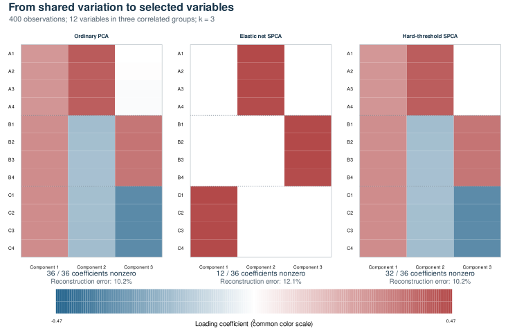

[](https://github.com/erichson/spca/actions/workflows/R-CMD-check.yaml)
[](https://CRAN.R-project.org/package=sparsepca)

# Sparse PCA: fewer variables, clearer components

Principal component analysis compresses many measurements into a few useful
directions. A component might summarize a pattern shared by hundreds of
genes, pixels, sensors, or survey responses. That compression is valuable,
but ordinary PCA usually assigns a nonzero coefficient to every variable.
Understanding what a component represents can become difficult.

**sparsepca** fits components that use only a subset of the original
variables. Zero coefficients make the contributing variables explicit.
The tradeoff is deliberate: a simpler component may retain less variation
than its ordinary PCA counterpart. Sparsity can help interpretation and
regularization; it does not by itself guarantee a stable scientific finding
or prevent overfitting.

The package provides three related methods:

| Function | Useful when |
| --- | --- |
| `spca()` | You want a deterministic sparse fit and the matrix fits comfortably in memory. |
| `rspca()` | The data are large, a small number of components is useful, and a randomized approximation is appropriate. |
| `robspca()` | Some individual entries may be grossly corrupted, and a sparse additive error model is meaningful. |

All three use variable projection, developed in the
[package paper](https://doi.org/10.1137/18M1211350). They share loading,
score, reconstruction, and prediction conventions.

## Installation

```r
install.packages("sparsepca")

# Development version:
# install.packages("remotes")
# remotes::install_github("erichson/spca")

library(sparsepca)
```

The repository is named **spca**; the R package is **sparsepca**.
The development version is **1.0.0**; the CRAN badge shows the published
version. Runtime requirements are R 4.0.0 or later, Matrix 1.3-0 or later,
and rsvd 1.0.5 or later.
Matrix does not need to be attached with `library(Matrix)`.

## A first fit

Each row is an observation and each column is a measured variable. Here we
fit two sparse components to the four measurements in `iris`:

```r
X <- as.matrix(iris[, 1:4])
fit <- spca(X, k = 2, alpha = 0.01, beta = 0.001,
            center = TRUE, scale = TRUE, verbose = FALSE)

round(fit$loadings, 3)       # Variable coefficients
colSums(fit$loadings != 0)   # Active variables in each component
head(fit$scores)            # Observations in component coordinates
summary(fit)
```

`alpha` encourages zeros. `beta` adds ridge shrinkage, which can stabilize
the fit when variables are strongly correlated. The default is to center
columns and **not** scale them. Scaling is enabled above because the choice
between covariance and correlation analysis should be explicit. Keep the
original units when their relative magnitudes carry meaning; scale when
variables should have comparable weight despite different units.

The returned loadings retain the scale chosen by the penalized optimization.
They need not have unit length or be orthogonal, and the component scores
can be correlated. Their signs can flip without changing the represented
model.



This self-contained example has three correlated groups of four variables.
Ordinary PCA uses all 36 coefficients. The illustrated elastic net fit uses
12, isolating the groups, with reconstruction error increasing from 10.2%
to 12.1%. The hard-threshold fit uses 20 coefficients and retains a different
basis with 10.2% error. These are three-component fits of the same processed
data; different penalties need not select the same variables. White cells
are zero coefficients. [Reproduce the figure and inspect the saved
coefficients](tools/documentation/README.md).

## Two factors with different jobs

A low-rank approximation represents a large matrix using a small number of
shared patterns. For a processed data matrix X with `n` observations and
`p` variables, sparsepca uses two `p`-by-`k` factors:

```math
Z = XB, \qquad \widehat{X} = ZA^{T}.
```

**B**, returned as `loadings`, tells us how to combine measured variables
into scores **Z**. **A**, returned as `transform`, combines those scores
back into the original variable coordinates. A has orthonormal columns;
B is encouraged to contain zeros. `transform` is a reconstruction factor,
not an exact inverse of `loadings`.

The default elastic net fit minimizes

```math
\frac{1}{2}\|X-XBA^{T}\|_F^2
+ \lambda_1\|B\|_1 + \frac{\lambda_2}{2}\|B\|_F^2,
\qquad A^{T}A=I.
```

The squared Frobenius norm is the sum of squared residual entries. The
absolute-value penalty encourages zero coefficients; the squared penalty
shrinks them. Internally, `lambda_1 = alpha * d1^2` and
`lambda_2 = beta * d1^2`, where `d1` is the largest singular value of the
processed matrix, or of its sketch for `rspca()`. Returned `alpha` and
`beta` contain these **effective penalties**. The arguments are relative
penalty strengths, not the literal coefficients in the displayed objective.

With `alpha = beta = 0`, deterministic `spca()` recovers ordinary PCA with
matching centering and scaling, up to signs and basis choices in tied
singular subspaces. Sparse fits accept extra reconstruction error in
exchange for simpler coefficients. Keeping only `k` components also
discards information, even if no sparsity penalty is used.

Scores and the reconstruction factor require `k * (n + p)` numeric entries;
a reconstructed matrix requires `n * p`. The fitted object also retains
the `p * k` loading entries and diagnostics. Factors are useful without
forming a full reconstruction, but requesting one allocates a dense matrix:

```r
reconstructed <- tcrossprod(fit$scores, fit$transform)
if (!isFALSE(fit$scale)) {
  reconstructed <- sweep(reconstructed, 2, fit$scale, "*")
}
if (!isFALSE(fit$center)) {
  reconstructed <- sweep(reconstructed, 2, fit$center, "+")
}
```

## How variable projection fits the model

Once B is fixed, the best orthogonal reconstruction factor A comes from a
small singular value decomposition of `crossprod(X, X %*% B)`. The solver
can therefore eliminate that part of the optimization analytically. It then
takes a gradient step for B and applies a threshold that encourages zeros.
Repeating these steps improves the penalized reconstruction objective.

This structure makes each update inexpensive after the initial matrix
factorization. It also makes the penalty interchangeable: the default
`penalty = "elasticnet"` uses soft thresholding;
`penalty = "l0"` uses hard thresholding and penalizes the **number** of
nonzero coefficients. With `penalty = "l0"` and `beta > 0`, the combination
is often called *ZeroNet*. These penalties use different units, so the
same `alpha` does not imply comparable sparsity across them.

The joint optimization is nonconvex. A fit is a solution reached from its
initialization, not a guarantee of the global optimum. Inspect the
recorded history and work limit:

```r
plot(fit$objective, type = "l", xlab = "Iteration",
     ylab = "Penalized objective")
c(iterations = fit$iterations, converged = fit$converged)
```

`converged` records the objective-based stopping criterion. Tightening
`tol` or increasing `max_iter` may refine the fit; neither is a test of
scientific validity or a guarantee of a global solution.

## Choosing a sparsity level

Start with the number of components your analysis can use, then examine a
range of penalties. A path reuses preprocessing and the initial matrix
factorization, and passes each fitted loading matrix to the next fit:

```r
path <- spca_path(X, k = 2, alpha = c(0.001, 0.005, 0.01, 0.03),
                  beta = 0.001, scale = TRUE, verbose = FALSE)
print(path)
path$nonzero             # Active coefficients per component
path$selected_features   # Variables active in at least one component
candidate <- path$fits[[3]]
```

The supplied order is preserved. Starting with a weak penalty and increasing
it is often convenient. Reusing a previous fit can change the local solution
relative to a fresh SVD initialization. A warm start is also available
directly through `B_init = previous_fit$loadings` when the variable order,
component count, and preprocessing match.

`alpha` encourages sparsity rather than enforcing a chosen feature count.
Counts can jump, and paths need not be monotone because the problem is
nonconvex. Inspect both per-component counts and the union of selected
variables: one variable can contribute to several components. Compare
held-out reconstruction, interpretability, and stability across sensible
data splits. For a randomized fit, also check sensitivity to the sketch seed.

## Randomized SPCA: solve a smaller problem

`rspca()` first finds an orthonormal basis Q that captures much of the
data's dominant variation. It projects the observations into that basis:

```math
C = Q^{T}X.
```

The expensive optimization then uses the smaller matrix C. The original
variables remain columns, so sparse coefficients retain their meaning.
Final scores are computed from the full processed data as `X %*% B`.
The recorded objective is the **sketch objective**; compare full-data
reconstruction when assessing approximation quality against `spca()`.

```r
set.seed(42)
fast <- rspca(X, k = 2, alpha = 0.01, scale = TRUE,
              o = 20, q = 2, verbose = FALSE)
```

The sketch width is `min(k + o, nrow(X), ncol(X))`. Oversampling `o` gives
the basis extra room. Power iterations `q` improve separation between
dominant and weaker directions, at the cost of additional matrix products.
The defaults are `o = 20` and `q = 2`; **1.0.0 now honors `q`**, which
older code inadvertently fixed at two. A converged fit can still have
an inaccurate sketch: `o` and `q` control subspace approximation, while
`tol` and `max_iter` control optimization on that sketch.

The advantage is largest when the sketch is much smaller than the input
and the singular values decay. It diminishes for small matrices, large
requested ranks, or spectra with no dominant subspace. More power
iterations cannot make a very small rank explain an intrinsically
high-dimensional signal. Set the seed before calling `rspca()` for
reproducible random draws; numerical libraries can still choose different
signs or bases in tied subspaces.

## Sparse data and sparse loadings are different

Sparse **input** stores many zeros efficiently. Sparse **loadings** use few
variables in each component. You can have either without the other.

Centering usually turns input zeros into nonzeros. `rspca()` avoids storing
that full centered matrix: it computes a sparse product and subtracts the
corresponding mean correction. Scaling is also applied through the products.

```r
X_sparse <- Matrix::bdiag(outer(1:20, 1:6),
                           outer(1:20, 6:1),
                           outer(1:20, 1:6))
set.seed(42)
sparse_fit <- rspca(X_sparse, k = 3, alpha = 0.005,
                    scale = TRUE, o = 5, verbose = FALSE)
```

| Routine | Input storage and dense work |
| --- | --- |
| `rspca()` | Preserves sparse input for products and implicit preprocessing. The basis, sketch, loading factors, and returned scores are dense. |
| `spca()` | Converts sparse input to a dense matrix for deterministic preprocessing and factorization. |
| `robspca()` | Uses dense input, residuals, and an `n`-by-`p` sparse-error array stored as an ordinary matrix. |
| `predict()` | Uses the fitted transformation; predicted scores are dense. |

For sketch width `ell`, the main randomized arrays have dimensions
`n * ell`, `ell * p`, `p * k`, and `n * k`, in addition to input storage
and factorization workspace. A large `k` or large oversampling value can
still require substantial memory. The zero coefficients in `loadings`
are represented in an ordinary R matrix rather than a compressed sparse
output class.

## Robust SPCA: separate unusual entries

`robspca()` introduces an additive error matrix S:

```math
X \approx XBA^{T} + S.
```

Its objective uses the squared residual `X - XBA' - S`, the loading
penalties, and `gamma * sum(abs(S))`. Minimizing over S is equivalent to
applying an entrywise Huber loss to the reconstruction residual. This is
appropriate when an additive sparse-error model describes the problem;
it is not a general guarantee against every kind of outlier or model error.
Centering and scaling themselves use ordinary means and sums of squares.

```r
set.seed(42)
signal <- matrix(rnorm(120 * 2), 120, 2)
weights <- matrix(0, 8, 2)
weights[1:4, 1] <- 1
weights[5:8, 2] <- 1
noisy <- tcrossprod(signal, weights) + matrix(rnorm(120 * 8, sd = 0.1), 120)
noisy[cbind(c(3, 40, 99), c(1, 6, 4))] <- c(8, -10, 9)
robust <- robspca(noisy, k = 2, alpha = 0.001, gamma = 0.5,
                  verbose = FALSE)
low_rank <- tcrossprod(robust$scores, robust$transform)
processed_model <- low_rank + robust$sparse
```

`gamma` is measured in the **processed data units** and is not multiplied
by the leading singular value. Smaller values allow more residual entries
into S; sufficiently large values leave S zero and recover the ordinary
loss. The returned sparse component is also in processed units. Undo
column scaling for both components, and add the training means only once
when reconstructing original observations.

Version 1.0.0 corrects an objective bookkeeping error reported by Maria
Sans-Fuentes: previous code omitted S from the squared reconstruction
loss while charging its penalty. That could stop a fit as soon as the
recorded objective rose. The corrected residual follows the published
model, and regression tests check both the objective and continued
optimization when S is nonzero.

## What does “variance explained” mean here?

Ordinary PCA produces uncorrelated scores. Sparse components can overlap,
so adding their marginal variances can count the same variation more than
once. sparsepca uses the sequential adjustment of
[Zou, Hastie, and Tibshirani (2006)](https://doi.org/10.1198/106186006X113430):
each score column is residualized against preceding score columns, then
its squared norm is divided by `n - 1`.

The adjusted values retain the historical field name `eigenvalues`;
`sdev` is their square root. They are generally **not eigenvalues of a
covariance matrix**. Adjustment depends on component order and the scale
of the fitted coefficients. `score_variance` gives the unadjusted marginal
score quantities. With `center = FALSE`, these are uncentered squared
energies divided by `n - 1`, rather than centered sample variances.

`fit$var` is the corresponding total energy of the entire processed input,
including directions omitted from the fit. Summary proportions divide
by this total, not by the sum of retained components. They need not add
up to one. These statistics were corrected in 1.0.0; see
[NEWS](NEWS.md) for their differences from the old auxiliary-SVD values.

Loadings are coefficients, not variable–component correlations. If
correlations are the quantity you want, calculate them directly, for
example `cor(X, fit$scores)` for the complete training data above.
Multiplying loadings by `sdev` does not generally give these correlations
for a sparse fit.

## Predicting new observations

```r
training <- spca(iris[1:140, 1:4], k = 2, alpha = 0.01,
                 scale = TRUE, verbose = FALSE)
new_scores <- predict(training, iris[141:150, 1:4])
```

Prediction applies the training means and scales before multiplying by
the fitted loadings. Named variables are aligned to the complete training
column set; unnamed matrices must use training order. No new preprocessing
parameters are estimated. With no `newdata`, `predict(training)` returns
stored training scores. Robust predictions use the same linear score map;
they do not estimate a new sparse corruption matrix.

## Measured performance

<!-- BEGIN BENCHMARK RESULTS -->
The following experiments use ten components and identical centering, with
no column scaling. Times are medians of three fresh R processes on a shared
Linux virtual machine, using **one BLAS thread**. Speedup is the reference
median divided by the randomized median. Error is the Frobenius norm of the
**full-input** reconstruction residual divided by the input norm, so it
includes information missed by a sketch.

### Comparison with ordinary PCA

Setting `alpha = beta = 0` makes sparsepca solve the ordinary PCA problem.
This gives a matched external reference in `stats::prcomp(rank. = 10)`:

| Data | `prcomp` seconds | `rspca` seconds | Speedup | Relative error, PCA / RSPCA |
| --- | ---: | ---: | ---: | ---: |
| Low-rank signal, 10,000 × 3,000 | 36.939 | 7.283 | 5.07× | 0.07107 / 0.07107 |
| Gaussian noise, 2,000 × 600 | 0.967 | 0.256 | 3.78× | 0.98073 / 0.98261 |

`prcomp` uses R's deterministic SVD; requesting ten components limits the
returned vectors but does not make its factorization a randomized truncated
SVD. Both methods return scores. These measurements concern the unpenalized
special case and do not compare ordinary PCA with a sparsity-penalized fit.

The noisy low-rank case retains the same reconstruction accuracy to the
reported precision. The Gaussian case has no small dominant subspace:
PCA captures 3.816% of input energy, while the randomized fit captures
3.448%. The modest difference between two large residuals conceals a
meaningful loss of leading-subspace accuracy. Every optimizer converged;
that fact alone does not establish a sufficiently accurate sketch.

### Acceleration of sparse fitting

For sparse loadings, the appropriate within-package reference is `spca()`.
Both methods use `alpha = 0.001`, `beta = 0.0001`, `tol = 1e-5`, and at
most 500 iterations. Randomized fits use `o = 20`, `q = 2`.

| Matrix | `spca` seconds | `rspca` seconds | Speedup | Relative error, SPCA / RSPCA |
| --- | ---: | ---: | ---: | ---: |
| 2,000 × 600 | 1.462 | 0.192 | 7.61× | 0.07282 / 0.07282 |
| 5,000 × 1,500 | 7.446 | 1.624 | 4.58× | 0.07735 / 0.07739 |
| 10,000 × 3,000 | 45.386 | 4.850 | 9.36× | 0.08365 / 0.08365 |

These simulated inputs contain ten loading groups plus noise. Both methods
produce 90% zero loading coefficients. They use the same relative penalties;
the saved results also compare full-input objectives under one common
spectral scale, because the randomized solver estimates its scale from the
sketch. Noise and sparsity both leave nonzero reconstruction residuals.


The plots include observed timing ranges, which are substantial on this
shared machine and are not confidence intervals. Smaller cases do not
necessarily have smoother or more predictable speedups.

### Memory with sparse input

On a 10,000 × 3,000 input with 10% stored entries, implicit preprocessing
also avoids the full dense conversion:

| Input path | Seconds | Peak resident memory | Relative error |
| --- | ---: | ---: | ---: |
| `rspca(as.matrix(X))` | 7.065 | 1,354.3 MiB | 0.05559 |
| `rspca(X)` | 2.733 | 342.2 MiB | 0.05559 |


Memory is the **whole R process high-water mark through fit completion**,
including the runtime, namespaces, input storage, a small warm-up,
preprocessing, fitting, and the result. It is not incremental memory or
cumulative allocation. Timing includes preprocessing and result construction;
the dense branch also includes `as.matrix(X)`. Input generation, loading,
warm-up, and subsequent quality calculations are outside the timer.

The recorded environment is R 4.6.1, Matrix 1.7-6, rsvd 1.0.6, Ubuntu
24.04.3, and OpenBLAS 0.3.26/LAPACK 3.12.0 on a virtualized Intel Xeon
Platinum 8573C system. All 36 measured fits converged without warnings.
The [benchmark guide](tools/benchmarks/README.md) records seeds, hardware,
thread settings, reference work, and all measurement definitions;
[raw measurements](tools/benchmarks/results/measurements.csv),
[summary tables](tools/benchmarks/results/tables.md), and the generating
scripts are retained. These are reproducible measurements of this software
and machine, not universal speed or memory guarantees.
<!-- END BENCHMARK RESULTS -->

## Documentation, examples, and development

`?spca`, `?rspca`, `?robspca`, `?spca_path`, and `?predict.spca` document
the full public contract and include small runnable examples.
[CONTRIBUTING](CONTRIBUTING.md) describes tests and documentation generation;
[NEWS](NEWS.md) records behavior changes.

The repository also retains the original
[ordinary](plots/eigenfaces.png), [sparse](plots/sparseeigenfaces.png), and
[robust sparse](plots/robustsparseeigenfaces.png) eigenface illustrations.
They are historical examples based on cropped Extended Yale Face Database B
images, not newly computed 1.0.0 results. The original research dataset has
its own distribution conditions; these retained illustrations do not grant
additional rights to the source photographs. The self-contained examples
above require no face-data download.

## References and citation

- Erichson, N. B., Zheng, P., Manohar, K., Brunton, S. L., Kutz, J. N., and
  Aravkin, A. Y. (2020). [Sparse Principal Component Analysis via Variable
  Projection](https://doi.org/10.1137/18M1211350). *SIAM Journal on Applied
  Mathematics*, 80(2), 977–1002.
- Zou, H., Hastie, T., and Tibshirani, R. (2006). [Sparse Principal Component
  Analysis](https://doi.org/10.1198/106186006X113430). *Journal of Computational
  and Graphical Statistics*, 15(2), 265–286.
- Erichson, N. B., Voronin, S., Brunton, S. L., and Kutz, J. N. (2019).
  [Randomized Matrix Decompositions Using R](https://doi.org/10.18637/jss.v089.i11).
  *Journal of Statistical Software*, 89(11), 1–48.

Run `citation("sparsepca")` for a citation and BibTeX entry.
