[](https://github.com/erichson/spca/actions/workflows/R-CMD-check.yaml)
[](https://CRAN.R-project.org/package=sparsepca)

# Interpretable components with sparse PCA

Many datasets contain groups of variables that vary together. Genes share
expression patterns, nearby pixels respond to the same lighting, and
sensors measure a common physical process. Principal component analysis
(PCA) represents these patterns with a few coordinates that can be plotted
or used in a subsequent model.

An ordinary principal component usually combines every measured variable.
Even when two coordinates describe a dataset well, each coordinate may
still involve thousands of coefficients. Relating those coordinates to
specific measurements can be difficult.

**sparsepca** fits components with many coefficients equal to zero. The
variables contributing to each component are then explicit. A component
might summarize four related measurements while assigning zero weight to
the other columns. Sparsity introduces a tradeoff between reconstruction
accuracy and the complexity of each component's description.

This tutorial develops that tradeoff through flower measurements, groups
of related variables, corrupted sensors, and face images. The examples
introduce the model and its parameters before moving to randomized fitting
for large matrices. Sparse loadings help interpret a component; sparse
input storage helps manage memory. The two can be used together, as the
[performance experiments](#measured-performance) illustrate.

[Getting started](#getting-started) ·
[the model](#two-factors-with-different-jobs) ·
[choosing sparsity](#choosing-the-number-of-components-and-the-sparsity) ·
[randomized fitting](#randomized-spca-solve-a-smaller-problem) ·
[sparse input](#sparse-data-and-sparse-loadings-are-different) ·
[robust fitting](#robust-spca-separate-unusual-entries) ·
[eigenfaces](#application-from-eigenfaces-to-localized-features) ·
[performance](#measured-performance)

## Getting started

The repository is named **spca** and the R package is **sparsepca**. This
README describes version **1.0.0**, including prediction, penalty paths,
approximate feature-count selection, and support for sparse input. The
CRAN badge shows the published version,
which may be older. Install the repository version to run the complete
tutorial.

<!-- example: install-development; eval: false -->
```r
install.packages("remotes")                 # Once, if needed
remotes::install_github("erichson/spca")
```

For the version published on CRAN, use `install.packages("sparsepca")`.
Some examples require features added in 1.0.0. Runtime requirements are
R 4.0.0 or later, Matrix 1.3-0 or later, and rsvd 1.0.5 or later. Matrix
functions are available to the package without attaching `library(Matrix)`.

<!-- example: load-package -->
```r
library(sparsepca)
packageVersion("sparsepca")
```

The fitting functions share their main arguments and result conventions.
Choose a routine according to the size of the matrix and the measurement
errors you expect.

| Function | Suitable use |
| --- | --- |
| `spca()` | Deterministic sparse fitting when the matrix fits comfortably in memory. |
| `rspca()` | Large matrices for which a randomized approximation with relatively few components is appropriate. |
| `robspca()` | Measurements with gross errors in individual entries, modeled as sparse additive corruption. |

Use `spca_path()` to compare sparsity penalties, `spca_target()` to search
for a desired number of variables, and `predict()` to calculate scores for
new observations. The fitting algorithms use variable projection,
as developed in the [package paper](https://doi.org/10.1137/18M1211350).

## A first application: four measurements, two coordinates

The built-in `iris` dataset contains four flower measurements for 150
observations. Arrange the measurements with **observations in rows** and
**variables in columns**. Species labels can help interpret a plot, but
the fit uses only the measurements.

<!-- example: iris-fit -->
```r
X <- as.matrix(iris[, 1:4])

fit <- spca(X, k = 2, alpha = 0.01, beta = 0.001,
            center = TRUE, scale = TRUE,
            tol = 1e-8, max_iter = 3000, verbose = FALSE)

data.frame(variable = colnames(X), round(fit$loadings, 3))
colSums(fit$loadings != 0)
head(fit$scores)
```

The `loadings` matrix gives the coefficients that define each coordinate.
The `scores` matrix gives each flower's position in those coordinates.
In this example, the first component uses sepal length, petal length,
and petal width; the second uses only sepal width. The fit has four nonzero
coefficients out of eight possible entries, compared with eight for
ordinary two-component PCA.

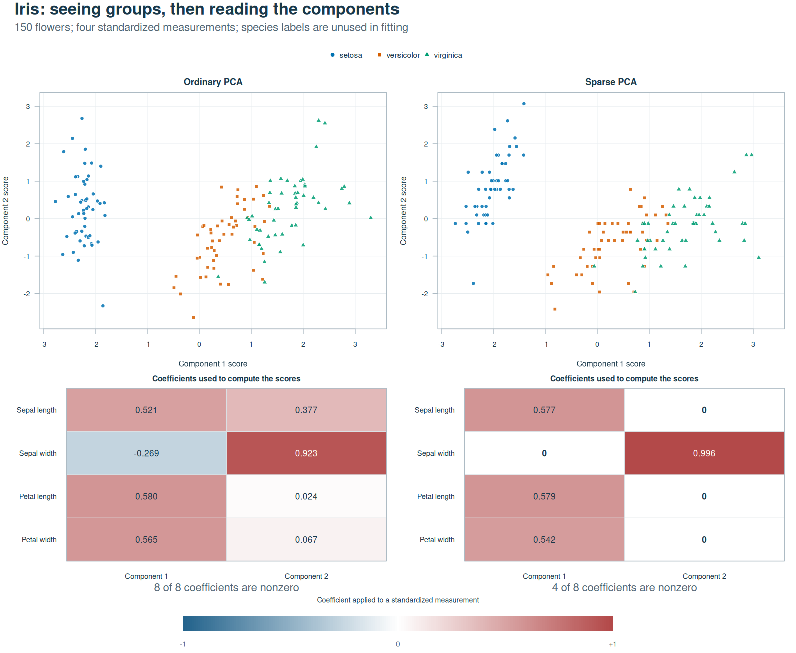

Reducing the number of coefficients from eight to four increases relative
reconstruction error on the standardized data from **20.5% to 21.1%**.
The sparse axes differ from ordinary PCA's axes because the fit also
penalizes their complexity. Species colors help describe the score maps;
no classifier has been trained. The
[figure script and saved results](tools/documentation/README.md) record
the preprocessing, coefficients, and error calculations.

A component and its score column can change sign together without
changing the model. Interpret the contributing variables and their relative
signs; the choice of which side of the plot is positive is arbitrary.
The scores can be plotted directly.

<!-- example: iris-score-plot -->
```r
plot(fit$scores[, 1], fit$scores[, 2],
     col = c("#0072B2", "#D55E00", "#009E73")[iris$Species],
     pch = 19, xlab = "Sparse component 1", ylab = "Sparse component 2")
legend("topright", legend = levels(iris$Species),
       col = c("#0072B2", "#D55E00", "#009E73"), pch = 19, bty = "n")
```

### Centering and scaling are part of the model

The iris fit uses `scale = TRUE` to give the four measurements comparable
weight in a correlation-based analysis. By default, sparsepca subtracts
column means and leaves column scales unchanged. In that case, variation
is measured in the original units, so columns with larger variation have
more influence on the approximation.

Centering makes the fit describe deviations from the average observation.
Use `center = FALSE` when zero is a meaningful origin that should remain
in the approximation. Scaling is useful when differences in units or
magnitudes would otherwise dominate the analysis. Both choices determine
which variation the components will describe.

For centered data, scaling divides each column by its sample standard
deviation. Without centering, the divisor is the square root of the
column's sum of squares divided by `n - 1`. Very small scale factors are
replaced by one, so a constant centered column remains zero. The fitted
means and scales are stored for prediction.

Supply numeric measurements, with identifiers and outcome labels kept
separately. Training omits rows containing `NA` or `NaN` with a warning;
infinite values are unsupported. Score rows correspond to the retained
complete observations, so keep their identifiers when joining scores to
other data. Prediction requires complete, finite new observations.

## Two factors with different jobs

The iris fit replaces four measurements with two scores for each flower.
More generally, a rank-`k` approximation describes an `n`-by-`p` data matrix
through observation coordinates and variable patterns. Storing those two
factors requires roughly `k * (n + p)` numbers instead of `n * p`.
Information outside the chosen patterns becomes reconstruction error,
including for ordinary PCA when `k` is below the data's numerical rank.

Let **X denote the data after the requested centering and scaling**.
sparsepca learns one factor to calculate scores and another to map those
scores back to the measured variables.

```math
Z = XB, \qquad \widehat{X} = ZA^{T}.
```

Each column of B specifies which variables contribute to a score. Each
column of A specifies how that score contributes to reconstruction. For
the iris fit, both factors have four rows and two columns, while Z has one
row per flower.

| Quantity | R component | Dimensions | Meaning |
| --- | --- | --- | --- |
| B | `loadings` | `p × k` | Sparse coefficients that combine measured variables into scores. |
| Z | `scores` | `n × k` | Observation coordinates, calculated as `X %*% B`. |
| A | `transform` | `p × k` | Orthogonal reconstruction factor that maps scores back to variable coordinates. |
| X̂ | Construct with `tcrossprod(scores, transform)` | `n × p` | Dense approximation in processed units. |

A has orthonormal columns. B retains the scale chosen by the penalized
fit and is generally neither normalized nor orthogonal. Reconstruction
therefore uses `transform`, rather than the transpose of `loadings` used
in an ordinary PCA reconstruction. The two factors are not exact inverses.

The fitted object stores the factors and scores, so plotting or analyzing
scores does not require constructing the dense approximation. To recover
fitted measurements in their original units, form the reconstruction,
reverse scaling, and then add the column means.

<!-- example: iris-reconstruction -->
```r
reconstructed <- tcrossprod(fit$scores, fit$transform)

if (!isFALSE(fit$scale)) {
  reconstructed <- sweep(reconstructed, 2, fit$scale, "*")
}
if (!isFALSE(fit$center)) {
  reconstructed <- sweep(reconstructed, 2, fit$center, "+")
}

head(reconstructed)
```

### Balancing reconstruction and sparsity

A fit that only minimizes reconstruction error has no reason to remove
variables from its score formulas. The default elastic net model adds a
penalty on the absolute coefficient values to encourage zeros, together
with a squared penalty that shrinks coefficients and can stabilize fits
with strongly correlated variables.

```math
\frac{1}{2}\|X-XBA^{T}\|_F^2
+ \lambda_1\|B\|_1
+ \frac{\lambda_2}{2}\|B\|_F^2,
\qquad A^{T}A=I.
```

The first term sums squared reconstruction errors over every observation
and variable. The next two terms penalize the magnitudes of B's entries.
A coefficient contributes to both penalties even if it makes only a small
improvement in the reconstruction, which can favor setting it to zero.

The API expresses penalty strengths relative to the data's leading
singular value.

```math
\lambda_1 = \mathtt{alpha}\,d_1^2,
\qquad
\lambda_2 = \mathtt{beta}\,d_1^2.
```

Here `d1` is the largest singular value of the processed data, or of its
sketch for `rspca()`. Returned `fit$alpha` and `fit$beta` contain the
scaled penalties used in the objective. This convention makes a penalty
choice less dependent on a common change of measurement units. Rescaling
individual columns can still change which variables are selected.

Setting `alpha = beta = 0` gives a useful reference. With default SVD
initialization, deterministic `spca()` recovers ordinary PCA under the same
centering and scaling, up to signs and basis choices within tied singular
subspaces. A custom `B_init` can instead remain in a different stationary
subspace, even with zero penalties.

## How variable projection fits the model

Once B is fixed, the best orthogonal reconstruction factor A can be
calculated from a small singular value decomposition. This removes A from
the numerical search over sparse coefficients. In particular, if

```math
X^{T}XB = UDV^{T},
```

then `A = U V'` minimizes the reconstruction error for that B. The solver
alternates this calculation with a gradient step for B followed by
thresholding. This procedure is called variable projection because one
part of the optimization is solved analytically within the other.

For the elastic net penalty, soft thresholding reduces each coefficient's
magnitude by a threshold and sets smaller coefficients to zero.

```math
\mathrm{soft}(u,\tau)
= \mathrm{sign}(u)\max(|u|-\tau,0).
```

For example, a coefficient of `0.3` becomes `0.2` when the threshold is
`0.1`, while a coefficient of `0.05` becomes zero. The update also
incorporates ridge shrinkage. The implementation reuses the initial
factorization and thin matrix products to avoid forming the full
reconstructed data matrix at each ordinary fitting iteration.

With `penalty = "l0"`, the sparsity penalty counts nonzero coefficients.
Hard thresholding discards sufficiently small coefficients and retains
the larger ones, without the soft threshold's additional subtraction from
each surviving magnitude. The combination of this count penalty and a
ridge penalty with `beta > 0` is often called *ZeroNet*. Because the two
sparsity penalties measure different quantities, equal `alpha` values
need not give equal numbers of nonzero coefficients.

The joint optimization is nonconvex, so initialization can affect which
solution is reached, particularly with hard thresholding. Objective
convergence describes the progress of a fit; it does not certify a global
optimum.

## Application: recover groups of related measurements

The iris coefficients can be inspected individually. When variables
arrive in larger groups, a loading map shows whether a component combines
related measurements or mixes several groups. The following example
constructs twelve variables from three correlated signals, with four
variables per signal.

<!-- example: grouped-data -->
```r
set.seed(20261017)
n <- 400
latent <- matrix(rnorm(n * 3), n, 3)
latent[, 2] <- 0.3 * latent[, 1] + latent[, 2]
latent[, 3] <- 0.2 * latent[, 1] + 0.3 * latent[, 2] + latent[, 3]
weights <- kronecker(diag(3), matrix(1, 4, 1))
grouped <- tcrossprod(latent, weights) +
  matrix(rnorm(n * 12, sd = 0.12), n, 12)
colnames(grouped) <- paste0(rep(c("A", "B", "C"), each = 4), rep(1:4, 3))

ordinary <- prcomp(grouped, rank. = 3, center = TRUE, scale. = TRUE)
elastic <- spca(grouped, k = 3, alpha = 0.02, beta = 0.001,
                scale = TRUE, tol = 1e-8, max_iter = 4000,
                verbose = FALSE)
hard <- spca(grouped, k = 3, alpha = 0.02, beta = 0.001,
             penalty = "l0", scale = TRUE,
             tol = 1e-8, max_iter = 4000, verbose = FALSE)
```

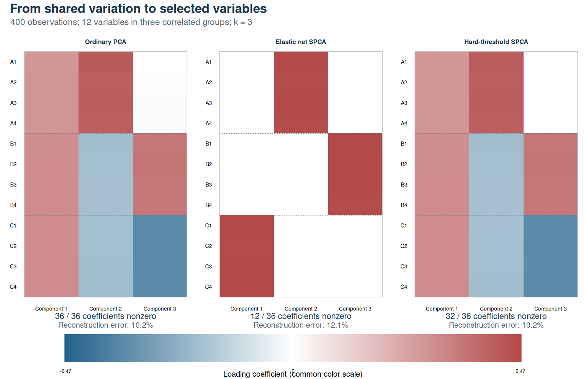

Ordinary PCA distributes the groups across all 36 coefficients. The
elastic net fit uses 12 and separates the three groups, while the
hard-threshold fit retains a different basis with 20 nonzero coefficients.
All fits use three components and the same processed data, allowing their
reconstruction errors to be compared directly.

| Fit | Nonzero coefficients | Relative reconstruction error |
| --- | ---: | ---: |
| Ordinary PCA | 36 / 36 | 10.2% |
| Elastic net SPCA | 12 / 36 | 12.1% |
| Hard-threshold SPCA | 20 / 36 | 10.2% |

The elastic net fit increases relative error from 10.2% to 12.1% while
making the known groups explicit. That correspondence gives the selected
variables an interpretation in this example. In other data, strongly
correlated variables may allow several sparse representations with similar
reconstruction quality.

Compute reconstruction error using the same centering and scaling as the
fit.

<!-- example: grouped-error -->
```r
grouped_processed <- scale(grouped, center = TRUE, scale = TRUE)
elastic_reconstruction <- tcrossprod(elastic$scores, elastic$transform)
norm(grouped_processed - elastic_reconstruction, "F") /
  norm(grouped_processed, "F")
```

The [reproduction guide](tools/documentation/README.md) retains the exact
coefficients, summaries, and figure script.

## Choosing the number of components and the sparsity

The grouped example fixes the component count at three because three
signals generated the data. In an application, choose `k` according to
the variation the representation should retain and the number of
coordinates that can be interpreted or used. Ordinary PCA with matching
preprocessing shows how much energy is available at each rank before
sparsity is imposed. Additional components need not reveal additional
useful structure.

For a chosen `k`, `alpha` controls the penalty on the variables contributing
to each coordinate. A large penalty can make an entire loading column
zero. Compare a range of values to see how selected measurements and
reconstruction change together.

<!-- example: penalty-path -->
```r
path <- spca_path(X, k = 2,
                  alpha = c(0.001, 0.005, 0.01, 0.03),
                  beta = 0.001, scale = TRUE,
                  tol = 1e-8, max_iter = 3000, verbose = FALSE)

print(path)
path$nonzero             # Nonzero coefficients in each component
path$selected_features   # Variables used by at least one component
candidate <- path$fits[[3]]
```

A regularization path reuses preprocessing and the initial factorization,
then passes each loading matrix to the next fit. It follows the supplied
penalty order; starting weak and increasing the penalty is often
convenient. Individual fits also accept
`B_init = previous_fit$loadings` when variables, column order, component
count, and preprocessing match.

Warm starts can reach different local solutions from separate SVD
initializations. Feature counts can jump or move in either direction as
the penalty changes. Treat `alpha` as a penalty strength rather than an
exact feature-count request. Inspect both the count in each component and
the union of selected variables, since one variable can contribute to
several components.

### Start with a desired number of measurements

An application may suggest how many measurements the representation should
use before it suggests a penalty strength. Suppose we want to calculate
two scores using about three of the four iris measurements. `spca_target()`
searches for a penalty that produces that count. The `n_features` argument
counts variables used by at least one component, so a measurement used in
both components is counted once.

<!-- example: target-features -->
```r
target <- spca_target(X, k = 2, n_features = 3,
                      beta = 0.001, scale = TRUE,
                      tol = 1e-8, max_iter = 3000, verbose = FALSE)

print(target)
target$search
selected <- target$fit
colnames(X)[rowSums(selected$loadings != 0) > 0]
```

The search shares preprocessing and one factorization, or one random
sketch with `method = "rspca"`. It starts with a small penalty grid and
uses warm starts to refine promising intervals if needed. Only converged
fits are eligible. By default, at most 30 fits are evaluated, and the
search stops when it finds the requested count. A supplied `alpha` grid
sets the initial sequence and range; `max_evals` controls the total search
budget.

Check `target$selected_features` and `target$target_met` to see what was
achieved. Counts can jump over the request, so a completed search can
return the closest converged candidate with `target_met = FALSE`.
`count_tol = 1` accepts a count within one variable of the request, while
`tol` controls numerical convergence within each fit. If no candidate
converges, the function warns and returns `fit = NULL`; the search record
shows which fits reached their iteration limits. The chosen fit retains
its estimated coefficients and supports the usual prediction methods.

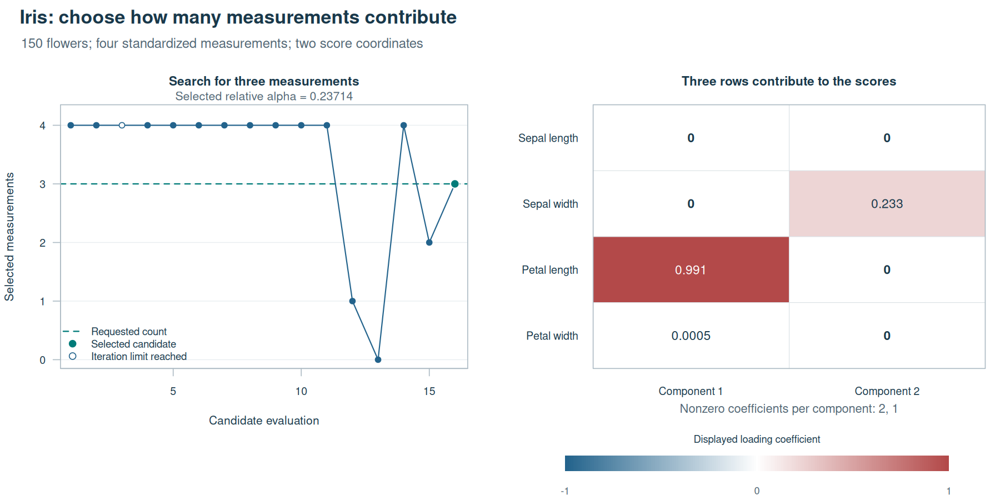

**The search finds three measurements after 16 candidate fits.** Its two
components use two and one nonzero coefficients, respectively. The left
panel follows evaluation order; the open circle marks a candidate that
reached its iteration limit and was ineligible for selection. The right
panel shows coefficients applied to standardized measurements, with
component signs chosen for display.

The selected variables are sepal width, petal length, and petal width.
Petal width's coefficient is only about 0.0005, so reaching a count of
three does not imply that all three contribute equally to the scores.
The relative reconstruction error is 0.562 on the standardized input.
The [reproduction guide](tools/documentation/target-features.md) contains
the complete search record and saved coefficients. Examine reconstruction
quality and the stability of the selected variables alongside the count.

The small petal-width coefficient suggests trying a representation with
two measurements. We can repeat the search with `n_features = 2`, keeping
the data and all other settings the same.

<!-- example: target-features-two -->
```r
target_two <- spca_target(X, k = 2, n_features = 2,
                          beta = 0.001, scale = TRUE,
                          tol = 1e-8, max_iter = 3000, verbose = FALSE)

colnames(X)[rowSums(target_two$fit$loadings != 0) > 0]

relative_error <- function(fit, X) {
  processed <- scale(X, center = fit$center, scale = fit$scale)
  reconstruction <- tcrossprod(fit$scores, fit$transform)
  norm(processed - reconstruction, "F") / norm(processed, "F")
}

c(three = relative_error(target$fit, X),
  two = relative_error(target_two$fit, X))
```

**The two-measurement fit has higher training reconstruction error.** Both
searches reach their requested counts with converged fits. The error is
the Frobenius norm of the reconstruction residual divided by the norm of
the standardized input.

| Measurements | Relative `alpha` | Relative error |
| ---: | ---: | ---: |
| 3 | 0.23714 | 0.56170 |
| 2 | 0.27028 | 0.63015 |

The second search selects petal length for the first score and sepal width
for the second. Their loading magnitudes decrease from 0.991 to 0.901 and
from 0.233 to 0.104, respectively. Asking for fewer measurements selects a
larger penalty here and refits the representation, changing the retained
coefficients as well as removing petal width. The comparison measures the
reconstruction quality of these two fitted models. Assessing which is
preferable for future observations requires held-out data.

### Apply the model to held-out observations

A fit can reconstruct its training data well while generalizing poorly.
Held-out observations let us assess the fitted representation on data
that did not determine its coefficients. `predict()` applies the training
means and scales, then multiplies by the fitted loadings, preserving the
coordinate system learned during training.

<!-- example: held-out-prediction -->
```r
set.seed(23)
training_rows <- sample(seq_len(nrow(X)), 120)
validation_rows <- setdiff(seq_len(nrow(X)), training_rows)

training <- spca(X[training_rows, ], k = 2,
                 alpha = 0.01, beta = 0.001, scale = TRUE,
                 tol = 1e-8, max_iter = 3000, verbose = FALSE)
validation_scores <- predict(training, X[validation_rows, ])

validation_processed <- sweep(X[validation_rows, ], 2, training$center, "-")
validation_processed <- sweep(validation_processed, 2, training$scale, "/")
validation_reconstruction <- tcrossprod(validation_scores, training$transform)

norm(validation_processed - validation_reconstruction, "F") /
  norm(validation_processed, "F")
```

This iris split illustrates the calculation. For model selection, compare
candidate penalties across training/validation splits, fitting
preprocessing on each training split. Examine reconstruction together with
support stability and the meaning of selected variables. When validation
results guide parameter choices, reserve separate test data for an
independent performance estimate.

When both training and new data have unique column names, prediction
matches the complete training column set, including variables with zero
loading rows. If either side is unnamed, supply columns in training order.
`predict(training)` returns the stored training scores. Robust fits use
the same linear score map for prediction; a new sparse corruption matrix
is not estimated.

### Read the convergence diagnostics

Each fit records its objective after every completed iteration. Inspecting
that history helps distinguish a fit that has stabilized from one that
stopped at the iteration limit.

<!-- example: objective-diagnostics -->
```r
plot(fit$objective, type = "l", xlab = "Completed iteration",
     ylab = "Penalized objective")
c(iterations = fit$iterations, converged = fit$converged)
```

`converged` reports whether the objective-based stopping criterion was
met. Reducing `tol` or increasing `max_iter` may refine a fit. The criterion
measures objective change, which does not bound coefficient error or the
gradient. A is updated before the final B update, and before the final S
update in robust fitting, so the returned blocks can have different
optimality errors.

At the iteration limit, inspect the history to judge whether further
iterations would help. An objective increase beyond the numerical allowance
produces a warning and is not recorded as convergence. In `rspca()`,
convergence concerns the optimization on the sketch. Its approximation
quality must be assessed on the full data.

## Randomized SPCA: solve a smaller problem

For large matrices, repeated products involving every observation can
dominate fitting time. `rspca()` reduces this work by first finding an
orthonormal basis Q for much of the data's dominant variation. It projects
the observations onto that basis and fits the resulting smaller matrix.

```math
C = Q^{T}X.
```

C retains a column for every original variable. Its sparse coefficients
therefore select among the measured variables, and scores are calculated
from the full processed data as `X %*% B` after fitting.

The grouped data illustrate how to use the randomized routine.

<!-- example: randomized-fit -->
```r
set.seed(42)
fast <- rspca(grouped, k = 3, alpha = 0.02, beta = 0.001,
              scale = TRUE, o = 5, q = 2,
              tol = 1e-8, max_iter = 4000, verbose = FALSE)

fast_reconstruction <- tcrossprod(fast$scores, fast$transform)
norm(grouped_processed - fast_reconstruction, "F") /
  norm(grouped_processed, "F")
```

This call reduces the 400-by-12 matrix to a sketch with at most eight rows.
The larger [benchmarks below](#measured-performance) measure the time saved
when the original matrix is large enough for repeated products to be
costly.

The sketch width is `min(k + o, nrow(X), ncol(X))`. Oversampling `o` gives
the basis room beyond the requested rank, helping it capture directions
near the truncation boundary. Power iterations `q` separate dominant
directions from weaker ones through additional products with the input
and its transpose.

| Choice | Effect on the fit |
| --- | --- |
| Larger `k` | Retains more coordinates, increases factor storage, and enlarges the optimization problem. |
| Larger `o` | Widens the sketch, which can improve approximation while using more memory and computation. |
| Larger `q` | Makes additional passes through the matrix to refine the randomized subspace. |
| Smaller `tol` / larger `max_iter` | Allows further optimization within the chosen sketch. |

The defaults are `o = 20` and `q = 2`. Version 1.0.0 honors the supplied
`q`; older code inadvertently fixed it at two. Use `set.seed()` before a
call to reproduce the random draws. The function follows R's random-number
stream, although numerical libraries can choose different signs or bases
within tied subspaces.

Randomization is most useful when `k + o` is much smaller than the matrix
dimensions and the singular values decay. A noisy, full-rank matrix can
still be well approximated by a small dominant subspace. With a flat
spectrum, many directions carry similar amounts of variation, so a small
sketch captures less of it. Increasing `q` can improve the selected
subspace, but cannot remove the reconstruction error imposed by the
chosen rank. Small matrices, large ranks, and wide sketches also reduce
the potential speed advantage.

The recorded `objective` describes the sketch, and the relative penalties
use its leading singular value. Compare `rspca()` and `spca()` through
reconstruction on the same full processed data, as in the example. Their
stored objective histories refer to different optimization problems.

## Sparse data and sparse loadings are different

Sparse loadings reduce the number of variables contributing to each
component. Sparse input storage reduces the memory needed to represent a
matrix containing many zeros. Dense measurements can produce sparse
loadings, while a sparse count matrix may require many variables to
represent its structure.

Version 1.0.0 uses the CRAN **Matrix** package to preserve sparse input
storage in `rspca()`. Centering needs particular care because subtracting
a nonzero column mean changes every implicit zero in that column. The
centered matrix can be dense even when the original measurements are
sparse. Instead of storing it, the routine applies the mean correction
during matrix products. For column means μ and a small matrix W,

```math
(X-\mathbf{1}\mu^{T})W
= XW-\mathbf{1}(\mu^{T}W).
```

The product on the right uses sparse X and applies the mean correction to
a much smaller result. Scaling is incorporated in the same way. This
computes the intended preprocessing without allocating a full centered
dense matrix.

<!-- example: sparse-input -->
```r
X_sparse <- Matrix::bdiag(outer(1:20, 1:6),
                           outer(1:20, 6:1),
                           outer(1:20, 1:6))
set.seed(42)
sparse_fit <- rspca(X_sparse, k = 3, alpha = 0.005,
                    scale = TRUE, o = 5, q = 2, verbose = FALSE)
dim(sparse_fit$scores)
colSums(sparse_fit$loadings != 0)
```

The small block matrix above demonstrates sparse storage and dispatch.
The [memory experiment](#memory-with-sparse-input) uses a larger matrix to
measure the allocation savings.

| Routine | Input storage and dense work |
| --- | --- |
| `rspca()` | Preserves sparse input for products and implicit preprocessing. The basis, sketch, factors, and returned scores are dense. |
| `spca()` | Converts sparse input to a dense matrix for deterministic preprocessing and factorization. |
| `robspca()` | Uses dense input, residuals, and an `n × p` sparse-error array stored as an ordinary matrix. |
| `predict()` | Multiplies sparse new data by the fitted loadings with training preprocessing; the predicted scores are dense. |

For sketch width `ell`, the main randomized arrays have dimensions
`n × ell`, `ell × p`, `p × k`, and `n × k`, in addition to the input
and factorization workspace. Rank and oversampling therefore still affect
memory use. Returned `loadings` use ordinary R matrix storage, including
for zero coefficients. The main saving comes from preserving the input's
sparse storage and avoiding its dense centered copy.

## Robust SPCA: separate unusual entries

Reducing memory and computation leaves the measurement model unchanged.
Another difficulty arises when a few sensor readings or pixels are much
larger than ordinary measurement noise. Squared reconstruction error can
give these entries enough influence to distort the shared patterns.
`robspca()` introduces a sparse matrix S to represent additive corruption,
so the processed observations are modeled as

```math
X \approx XBA^{T}+S.
```

The low-rank term describes shared variation, while S can absorb individual
errors. With the default loading penalty, the objective is

```math
\frac{1}{2}\|X-XBA^{T}-S\|_F^2
+ \lambda_1\|B\|_1
+ \frac{\lambda_2}{2}\|B\|_F^2
+ \gamma\|S\|_1,
\qquad A^{T}A=I.
```

The final penalty discourages assigning every residual to S. For fixed
factors, the minimizing error matrix is `soft(R, gamma)`, where
`R = X - XBA'`, with thresholding applied entry by entry. Eliminating S
therefore gives the entrywise Huber loss, which is quadratic for small
residuals and linear for large ones.

`gamma` sets the threshold in processed data units. It is used directly,
without multiplication by the leading singular value. Smaller values
allow more residual entries into S; values that keep S zero recover the
ordinary reconstruction loss. Use the scale of ordinary residual noise
after preprocessing to guide the choice. The default `gamma = 100` is
fixed rather than calibrated from the data and may leave S entirely zero,
particularly after standardization.

### Application: shared sensor signals with occasional spikes

Eight simulated sensors follow two smooth signals, with four measurements
altered by large spikes. The known clean signal lets us measure how well
each fitted reconstruction recovers the shared variation.

<!-- example: sensor-data -->
```r
set.seed(17)
time <- seq(0, 4 * pi, length.out = 120)
latent <- cbind(sin(time), cos(time))
weights <- matrix(0, 8, 2)
weights[1:4, 1] <- 1
weights[5:8, 2] <- 1

truth <- tcrossprod(latent, weights)
observed <- truth + matrix(rnorm(120 * 8, sd = 0.08), 120, 8)
spikes <- cbind(c(15, 45, 75, 105), c(1, 6, 3, 8))
observed[spikes] <- observed[spikes] + c(7, -7, 8, -8)
```

The signals have a meaningful zero baseline, so both fits use
`center = FALSE` and retain the original measurement units. They use the
same rank and loading penalties, with `gamma = 0.3` for the robust fit.

<!-- example: sensor-fits -->
```r
ordinary_sensor <- spca(observed, k = 2, alpha = 0.005, beta = 0.001,
                        center = FALSE, tol = 1e-8,
                        max_iter = 3000, verbose = FALSE)
robust <- robspca(observed, k = 2, alpha = 0.005, beta = 0.001,
                  gamma = 0.3, center = FALSE, tol = 1e-8,
                  max_iter = 3000, verbose = FALSE)

ordinary_signal <- tcrossprod(ordinary_sensor$scores,
                              ordinary_sensor$transform)
robust_signal <- tcrossprod(robust$scores, robust$transform)
identified_errors <- robust$sparse

c(ordinary = norm(truth - ordinary_signal, "F") / norm(truth, "F"),
  robust = norm(truth - robust_signal, "F") / norm(truth, "F"))
round(identified_errors[spikes], 2)
```

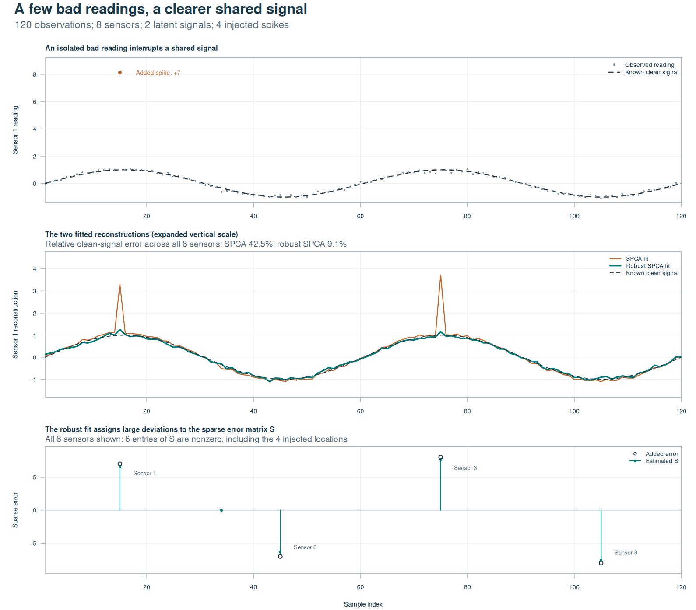

Relative reconstruction error against the clean signal falls from
**42.5% to 9.1%**. At the four injected locations, the estimated errors are
approximately `6.57, -6.34, 7.64, -7.53`. S contains six nonzero entries,
including two small errors beyond the injected locations. This fit shows
how an additive error model can improve signal reconstruction while also
illustrating that its nonzero entries need not exactly identify the true
corruption. The appropriate `gamma` depends on the residual noise and
the purpose of the analysis.

`robust_signal` contains the low-rank reconstruction.
`robust_signal + robust$sparse` describes the processed observations,
including estimated errors. S models errors in individual entries; it
can be interpreted at that level without assuming that an entire row is
an outlying subject.

Requested centering and scaling still use ordinary means and sums of
squares, which strong contamination can affect. Scores are also calculated
from the processed original observations. These choices matter when
contamination affects a whole row rather than a few entries, because the
fit does not make every score insensitive to that row.

To return a robust decomposition to original units, undo scaling for both
the low-rank and sparse components, then add the training means once to
the reconstructed observations. Robust fitting stores dense residual
arrays and an ordinary `n × p` matrix for S, so its memory requirements
include matrices with the full input dimensions.

### The robust objective correction in 1.0.0

Maria Sans-Fuentes identified an error in the recorded objective of earlier
code. The squared reconstruction loss omitted S even though the objective
included its penalty. When S became active, that inconsistent objective
could rise and stop optimization prematurely.

Version 1.0.0 evaluates the complete residual `X - XBA' - S`. The intended
variable updates are unchanged, and tests check both the corrected
objective and continued optimization with nonzero S. Fits affected by
the bug can run longer and produce different results.

## Application: from eigenfaces to localized features

The sensor example separates shared signals from unusual measurements.
For images, the same model acts on pixels. Flatten each image into a row
of X, and each loading coefficient refers to a particular pixel location.
Reshaping a loading vector as an image shows which parts of the face
contribute to a component's score.

Here we fit 25 components to 2,410 cropped images from the
[Extended Yale Face Database B](https://vision.ucsd.edu/datasets/extended-yale-face-database-b-b).
Each image has 96 × 84 pixels, giving 8,064 variables. All fits center
and standardize each pixel, so they describe deviations from the mean
face relative to the variation at that location. The figures and numerical
results below were computed with sparsepca 1.0.0 and an objective
tolerance of `1e-4` for each iterative fit. The
[reproduction guide](tools/documentation/eigenfaces.md) provides the data
source, full fitting commands, and saved factors.

### Ordinary eigenfaces combine pixels across the face

Ordinary PCA assigns a coefficient to every pixel. Its components describe
broad patterns of appearance and illumination, with positive and negative
regions contributing in opposite directions to a score. These patterns
are often called eigenfaces because the loading vectors are eigenvectors
of the processed data's covariance matrix.

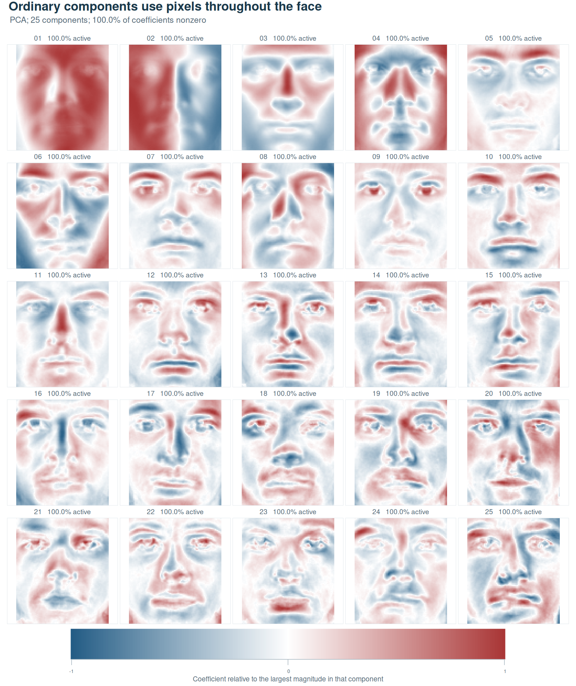

The 25-component approximation has a relative reconstruction error of
31.6%, measured on the full standardized data. For display, each loading
vector is divided by its largest absolute coefficient and oriented so that
entry is positive. The common color scale shows relative weights within
each component, with zero in white. The saved coefficients retain their
fitted magnitudes and signs.

### Sparse eigenfaces select fewer pixels

The first sparse fit uses `rspca()` with `alpha = 1e-4`, `beta = 0.1`,
`o = 20`, and `q = 2`. Penalizing the coefficients removes many pixel
locations from each score formula. The remaining weights show where the
selected measurements lie in the image.

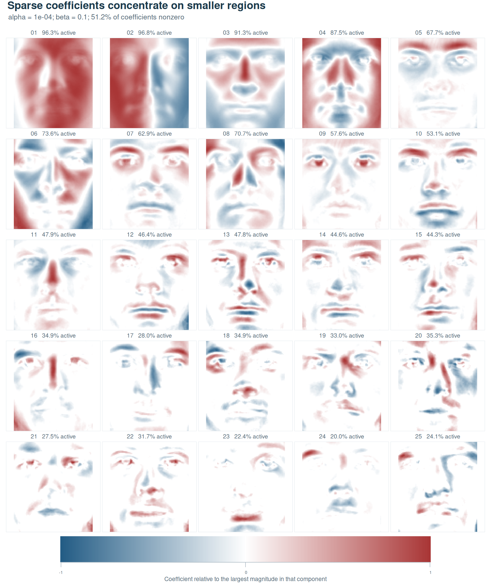

This fit retains 103,256 of 201,600 coefficients, or 51.2%, while relative
reconstruction error increases to 47.3%. The selected regions make the
score formulas easier to inspect spatially. The penalty acts on individual
coefficients, however, so neighboring pixels are not required to be selected
together.

### Stronger penalties simplify the score formulas further

Increasing `alpha` to `2e-4` and `beta` to `0.2` reduces the retained
coefficients to 31.6% and increases reconstruction error to 52.4%. Both
penalties change in this comparison. The larger absolute-value penalty
encourages zeros, while the larger ridge penalty also shrinks the surviving
coefficients.

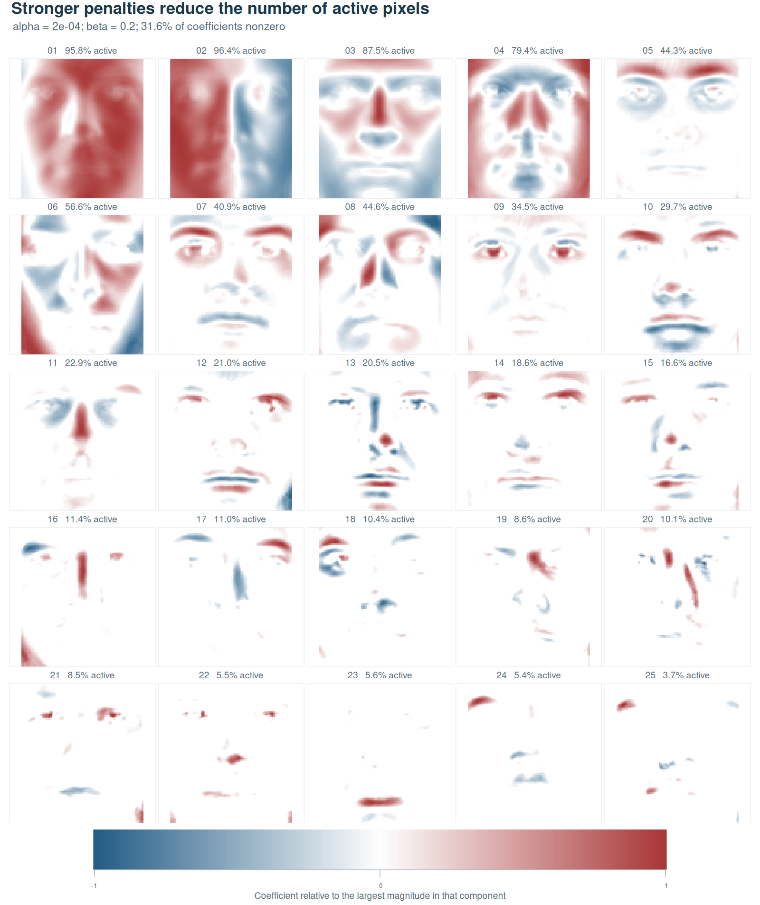

The first two components still use over 90% of the pixels, while several
later components use fewer than 10%, often around the eyes or mouth.
A common penalty therefore simplifies different score formulas to
different degrees. The table summarizes the overall tradeoff, with errors
measured as the Frobenius norm of the full-data residual divided by the
norm of the same processed input.

| Fit | Nonzero coefficients | Relative reconstruction error |
| --- | ---: | ---: |
| Ordinary PCA | 201,600 / 201,600 (100%) | 31.6% |
| Sparse PCA | 103,256 / 201,600 (51.2%) | 47.3% |
| Stronger penalties | 63,649 / 201,600 (31.6%) | 52.4% |

### Robust sparse eigenfaces separate large pixel residuals

Lighting changes can produce strong local differences between face images.
The robust model allows the sparse error term S to absorb large residuals
while the low-rank factors describe the shared variation. This fit uses
`alpha = 1e-4`, `beta = 0.01`, and `gamma = 0.9`, with the same rank and
preprocessing.

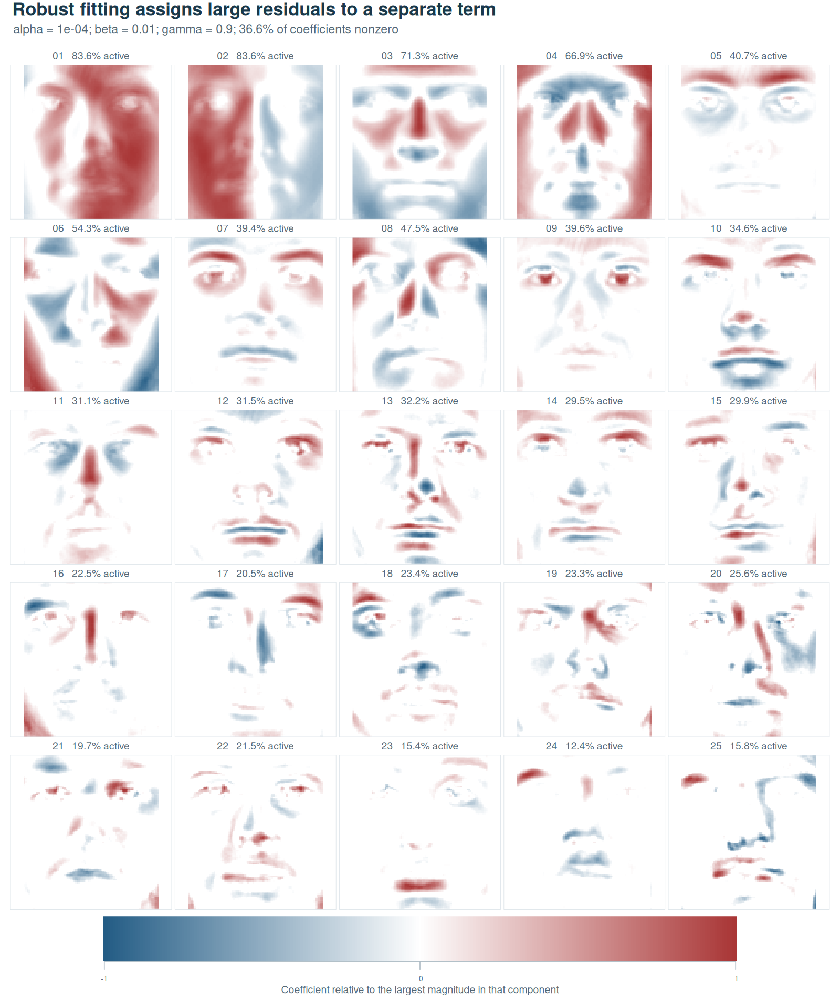

The robust fit retains 36.6% of the loading coefficients and reaches its
objective stopping criterion after 181 iterations. Its low-rank
reconstruction has a relative error of 38.4%, compared with 37.7% for a
deterministic `spca()` fit with the same loading penalties, rank,
preprocessing, and stopping tolerance. The robust objective allows large
residuals to enter S, changing how the model distributes variation
between its low-rank and additive terms.

The loading maps describe how the observed pixels are combined into scores.
The error maps below locate the additive residuals assigned to S for each
observation. They show the first 25 images in the
dataset order, with a common color scale in standardized pixel units.

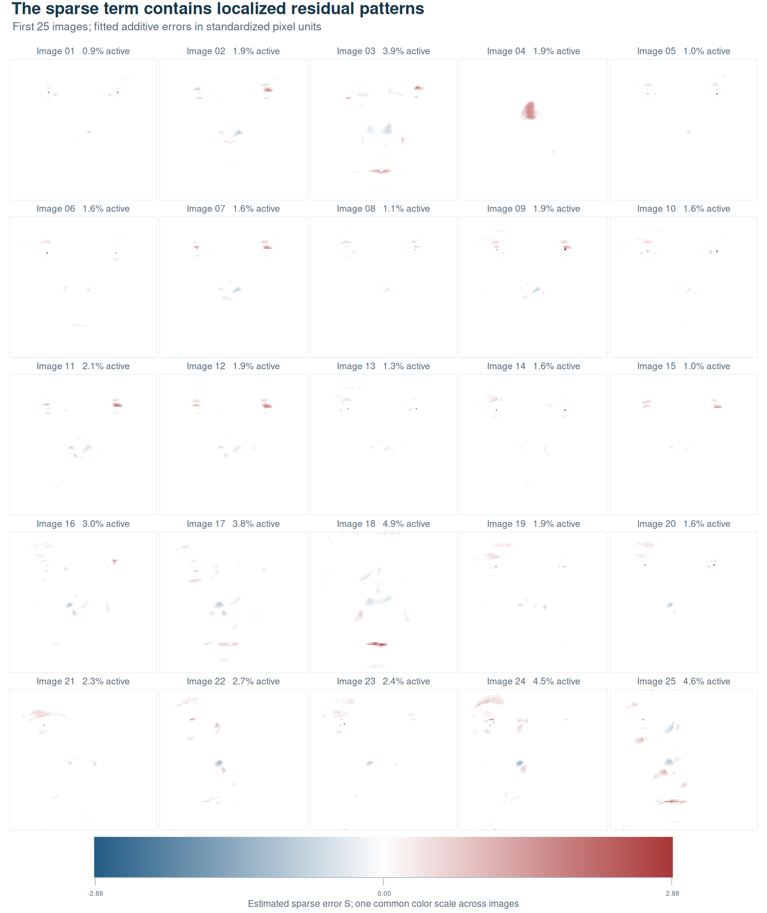

An entry of S is nonzero when the corresponding low-rank residual has
magnitude greater than `gamma`. Across the full dataset, 3.7% of pixel
measurements receive a nonzero additive term. Including S reduces the
relative residual from 38.4% to 33.4%, measuring how closely the complete
model represents the observed images. The physical interpretation of
each residual depends on the image and lighting conditions.

To apply this workflow to other images, retain a consistent pixel order.
Columns of `loadings` become coefficient maps; rows of
`tcrossprod(scores, transform)` become reconstructed observations; rows of
`sparse` become robust error maps.

<details>
<summary>Adapt the image workflow to a matrix of your own images</summary>

Prepare `face_rows` with one flattened grayscale image per row. The
following recipe assumes that each image was flattened with R's
`as.vector()`, so `matrix(..., nrow = height)` reverses that operation.
Set the dimensions and penalties for your own data. The full Yale
experiment uses its source-specific pixel ordering and the settings
recorded in the reproduction guide.

<!-- example: image-matrix-recipe; eval: false; reason: Requires a separately prepared face_rows image matrix -->
```r
height <- 96
width <- 84
stopifnot(ncol(face_rows) == height * width)

set.seed(42)
face_fit <- rspca(face_rows, k = 10, alpha = 0.001, beta = 0.0001,
                  center = TRUE, scale = FALSE, verbose = FALSE)

loading_image <- matrix(face_fit$loadings[, 1], nrow = height, ncol = width)
image(t(loading_image[height:1, ]), col = gray.colors(101),
      axes = FALSE, xlab = "", ylab = "")
```

This displays the coefficients that define one score. To reconstruct a
single observation without forming every reconstructed image,
multiply `face_fit$scores[1, , drop = FALSE]` by
`t(face_fit$transform)`, then add the stored pixel means before reshaping.
For robust fitting, the same reshaping applies to rows of
`face_fit$sparse` from a `robspca()` result, with component units handled
as described above.

</details>

The [face reproduction guide](tools/documentation/eigenfaces.md) includes
the dataset acknowledgement, [research-use terms](https://www.cs.yale.edu/cvc/projects/yalefacesB/yalefacesB.html),
and a script to redraw every panel from the saved factors. The iris and
sensor examples above provide complete workflows using built-in or
simulated data.


## What does “variance explained” mean here?

The applications compare fits through reconstruction error. The summary
also reports score energies, whose interpretation needs care when
components overlap. Ordinary PCA has orthogonal loadings and uncorrelated
centered scores. Sparse loadings can generate correlated scores, so
summing their marginal variances can count shared variation more than once.

sparsepca uses the sequential adjustment of
[Zou, Hastie, and Tibshirani (2006)](https://doi.org/10.1198/106186006X113430).
For each score column, it removes the projection onto the preceding score
columns and divides the remaining squared norm by `n - 1`. A score that
is already in the span of earlier columns contributes zero adjusted energy.

| Component | Interpretation |
| --- | --- |
| `eigenvalues` | Sequentially adjusted score energies divided by `n - 1`; the historical field name is retained. |
| `sdev` | Square roots of those adjusted values. |
| `score_variance` | Marginal squared score norms divided by `n - 1`, without removing overlap. |
| `var` | Total squared energy of the entire processed input divided by `n - 1`. |

For centered data, these are adjusted, marginal, and total sample-variance
quantities. With `center = FALSE`, they are uncentered energies using the
same denominator. The adjusted energies depend on component order and
coefficient scale. Despite the `eigenvalues` field name, they generally
differ from covariance eigenvalues and need not appear in descending order.

<!-- example: variance-interpretation -->
```r
summary(fit)
fit$eigenvalues
fit$score_variance
cor(X, fit$scores)
```

Summary proportions divide by total input energy, including variation
outside the retained components, so they need not sum to one. If total
energy is zero, those proportions are undefined and displayed as zero by
convention. Score energy describes the coordinates produced by B;
reconstruction error assesses their approximation through A. Keep these
quantities separate when comparing fits.

Loading coefficients also differ from variable–component correlations.
For the complete iris data, `cor(X, fit$scores)` calculates those
correlations directly. Multiplying sparse loadings by `sdev` generally
gives a different quantity, which matters when choosing arrows or labels
for a biplot.

## Measured performance

<!-- BEGIN BENCHMARK RESULTS -->
The following experiments use ten components and identical centering, with
no column scaling. Times are medians of three fresh R processes on a shared
Linux virtual machine, using **one BLAS thread**. Speedup is the reference
median divided by the randomized median. Error is the Frobenius norm of the
**full-input** reconstruction residual divided by the input norm, so it
includes information missed by a sketch.

### Comparison with ordinary PCA

Setting `alpha = beta = 0` makes sparsepca solve the ordinary PCA problem.
Comparing with `stats::prcomp(rank. = 10)` gives a deterministic reference
under the same preprocessing and target rank.

| Data | `prcomp` seconds | `rspca` seconds | Speedup | Relative error, PCA / RSPCA |
| --- | ---: | ---: | ---: | ---: |
| Low-rank signal, 10,000 × 3,000 | 36.939 | 7.283 | 5.07× | 0.07107 / 0.07107 |
| Gaussian noise, 2,000 × 600 | 0.967 | 0.256 | 3.78× | 0.98073 / 0.98261 |

`prcomp` computes a full deterministic SVD internally before retaining the
requested vectors. Both methods return scores and solve the unpenalized
problem.

The noisy low-rank case retains the same reconstruction accuracy to the
reported precision. Gaussian noise has no small dominant subspace, so
capturing its leading directions is harder. PCA captures 3.816% of input
energy, while the randomized fit captures 3.448%. The similar residuals
therefore correspond to a measurable difference in captured energy.
Every optimizer converged; evaluating the full-data reconstruction exposes
the approximation error left by the sketch.

### Acceleration of sparse fitting

For sparse loadings, the appropriate within-package reference is `spca()`.
Both methods use `alpha = 0.001`, `beta = 0.0001`, `tol = 1e-5`, and at
most 500 iterations. Randomized fits use `o = 20`, `q = 2`.

| Matrix | `spca` seconds | `rspca` seconds | Speedup | Relative error, SPCA / RSPCA |
| --- | ---: | ---: | ---: | ---: |
| 2,000 × 600 | 1.462 | 0.192 | 7.61× | 0.07282 / 0.07282 |
| 5,000 × 1,500 | 7.446 | 1.624 | 4.58× | 0.07735 / 0.07739 |
| 10,000 × 3,000 | 45.386 | 4.850 | 9.36× | 0.08365 / 0.08365 |

These simulated inputs contain ten loading groups plus noise. Both methods
produce 90% zero loading coefficients. They use the same relative penalties;
the saved results also compare full-input objectives under one common
spectral scale, because the randomized solver estimates its scale from the
sketch. Noise and sparsity both leave nonzero reconstruction residuals.

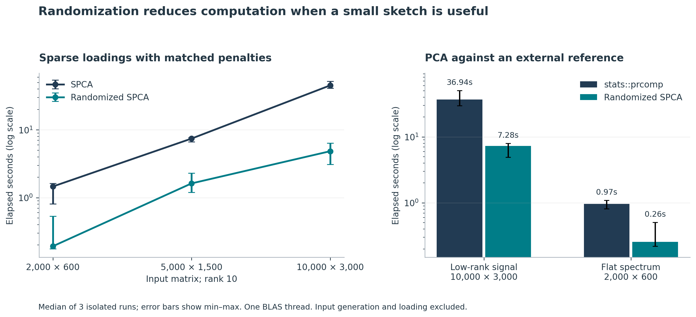

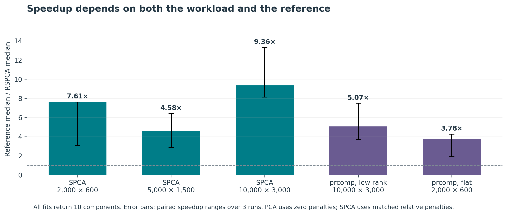

The timing ranges describe the spread of the three observed runs rather
than confidence intervals. Their width shows the variability on this
shared machine, including for smaller cases.

### Memory with sparse input

On a 10,000 × 3,000 input with 10% stored entries, implicit preprocessing
reduces memory use by preserving sparse storage through the fit.

| Input path | Seconds | Peak resident memory | Relative error |
| --- | ---: | ---: | ---: |
| `rspca(as.matrix(X))` | 7.065 | 1,354.3 MiB | 0.05559 |
| `rspca(X)` | 2.733 | 342.2 MiB | 0.05559 |

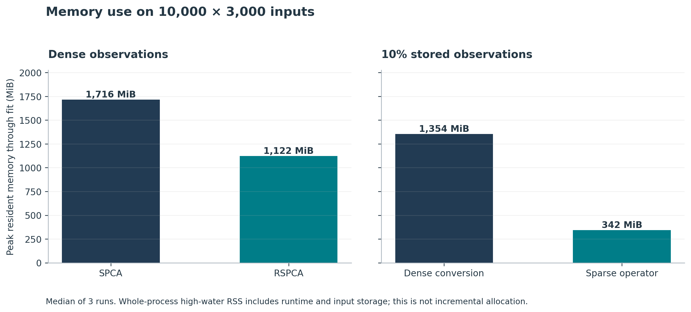

Memory is the **whole R process high-water mark through fit completion**,
including the runtime, namespaces, input storage, a small warm-up,
preprocessing, fitting, and the result. It is not incremental memory or
cumulative allocation. Timing includes preprocessing and result construction;
the dense branch also includes `as.matrix(X)`. Input generation, loading,
warm-up, and subsequent quality calculations are outside the timer.

The recorded environment is R 4.6.1, Matrix 1.7-6, rsvd 1.0.6, Ubuntu
24.04.3, and OpenBLAS 0.3.26/LAPACK 3.12.0 on a virtualized Intel Xeon
Platinum 8573C system. All 36 measured runs completed without warnings;
all iterative fits converged.
The [benchmark guide](tools/benchmarks/README.md) records seeds, hardware,
thread settings, reference work, and all measurement definitions;
[raw measurements](tools/benchmarks/results/measurements.csv),
[summary tables](tools/benchmarks/results/tables.md), and the generating
scripts are retained so the comparisons can be repeated with other matrix
sizes, spectra, and computing environments.
<!-- END BENCHMARK RESULTS -->

## Using sparse components in an analysis

Sparse PCA makes the variables contributing to each coordinate explicit.
In the grouped example, twelve elastic net coefficients reveal the three
measurement groups, with reconstruction error increasing from 10.2% to
12.1% compared with ordinary PCA. The value of sparsity comes from how
those selected variables relate to the application.

Begin with `spca()` and preprocessing that reflects the variation of
interest. A `spca_path()` comparison shows how support and reconstruction
change as the penalty increases. For large problems, `rspca()` reduces
computation when a small sketch captures the relevant subspace; assess
its full-data error and sensitivity to the random seed. `robspca()` adds
an error model when sparse additive contamination plausibly describes the
measurements.

A penalty value is specific to its preprocessing, rank, initialization,
and data distribution. Correlated variables can also produce several
similarly good sparse representations. Interpret the fitted coefficients
alongside reconstruction quality and stability, using knowledge of the
measurements to judge which representation is useful.

## Deeper documentation and development

Every public help topic includes argument definitions, result conventions,
and runnable examples.

| Help topic | Main content |
| --- | --- |
| `?spca` | Model, preprocessing, loading interpretation, and reconstruction. |
| `?rspca` | Sketch quality, parameters, and sparse-input memory. |
| `?robspca` | Error model, `gamma`, and component units. |
| `?spca_path` | Reused factorizations and penalty-path interpretation. |
| `?spca_target` | Search for an approximate variable count and inspect the achieved result. |
| `?predict.spca` | Training preprocessing and variable alignment. |
| `?summary.spca`, `?print.spca` | Displayed statistics. |

[NEWS](NEWS.md) records 1.0.0's behavior corrections and new capabilities.
[CONTRIBUTING](CONTRIBUTING.md) describes the numerical tests, package
checks, and authoritative documentation source. The
[documentation guide](tools/documentation/README.md) explains how to run
the tutorial and regenerate its application figures from saved results.
The [benchmark guide](tools/benchmarks/README.md) provides the larger
experiments and raw measurements.

The iris example uses R's
[documented iris dataset](https://stat.ethz.ch/R-manual/R-devel/library/datasets/html/iris.html).
The grouped measurements and sensor signals are simulated with recorded
seeds. The face images have the research provenance described in their
application section.

## References and citation

- Erichson, N. B., Zheng, P., Manohar, K., Brunton, S. L., Kutz, J. N., and
  Aravkin, A. Y. (2020). [Sparse Principal Component Analysis via Variable
  Projection](https://doi.org/10.1137/18M1211350). *SIAM Journal on Applied
  Mathematics*, 80(2), 977–1002.
- Zou, H., Hastie, T., and Tibshirani, R. (2006). [Sparse Principal Component
  Analysis](https://doi.org/10.1198/106186006X113430). *Journal of Computational
  and Graphical Statistics*, 15(2), 265–286.
- Erichson, N. B., Voronin, S., Brunton, S. L., and Kutz, J. N. (2019).
  [Randomized Matrix Decompositions Using R](https://doi.org/10.18637/jss.v089.i11).
  *Journal of Statistical Software*, 89(11), 1–48.

Run `citation("sparsepca")` for a citation and BibTeX entry.
