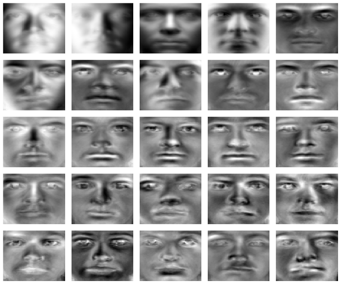
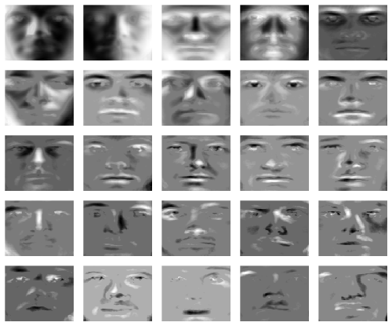
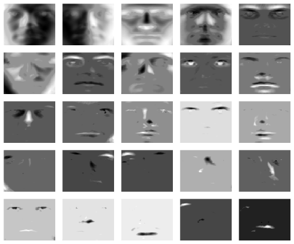
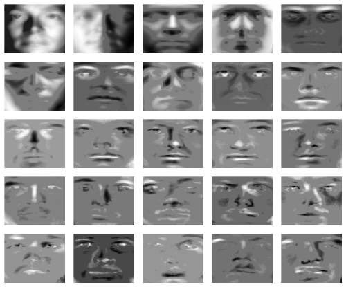
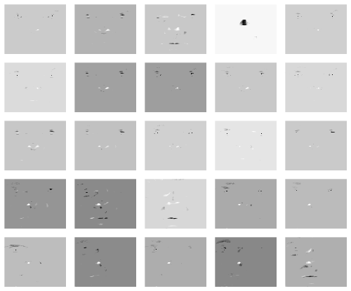

[](https://github.com/erichson/spca/actions/workflows/R-CMD-check.yaml)
[](https://CRAN.R-project.org/package=sparsepca)

# Sparse PCA: fewer variables, clearer components

A dataset can have thousands of columns and only a handful of important
patterns. Genes move together, nearby pixels share structure, and groups of
sensors respond to the same physical process. Principal component analysis
(PCA) summarizes those shared patterns with a few new coordinates. It is
one of the most useful ways to turn a large table into something we can
plot, store, or use in a subsequent model.

There is a catch: an ordinary principal component usually involves
**every variable**. A two-dimensional plot may be simple, while the recipe
for either axis still contains thousands of coefficients. What does that
axis represent? Which measurements would we need to calculate it?

**sparsepca** makes that recipe simpler. It fits components with many
coefficients equal to zero, so the variables contributing to each component
are explicit. A component might summarize four related measurements
instead of mixing every column in the table. We accept some extra
reconstruction error in exchange for that simpler description.

This tutorial develops the idea from a small flower dataset to grouped
measurements, corrupted sensors, and the original eigenface illustrations.
Along the way, it explains the model, the parameters, and the distinction
between interpretable **sparse loadings** and memory-efficient **sparse
input**. The [performance experiments](#measured-performance) show what
randomized fitting can save on larger problems.

**Read in order, or jump to:**
[getting started](#getting-started) ·
[the model](#two-factors-with-different-jobs) ·
[choosing sparsity](#choosing-the-number-of-components-and-the-sparsity) ·
[randomized fitting](#randomized-spca-solve-a-smaller-problem) ·
[sparse input](#sparse-data-and-sparse-loadings-are-different) ·
[robust fitting](#robust-spca-separate-unusual-entries) ·
[eigenfaces](#application-from-eigenfaces-to-localized-features) ·
[performance](#measured-performance)

## Getting started

The repository is named **spca**; the R package is **sparsepca**. This
README describes **version 1.0.0**, including its prediction, penalty-path,
and sparse-input features. The CRAN badge above shows the published
version, which may be older. To follow the complete tutorial, install this
repository version:

<!-- example: install-development; eval: false -->
```r
install.packages("remotes")                 # Once, if needed
remotes::install_github("erichson/spca")
```

For the version currently published on CRAN, use
`install.packages("sparsepca")` instead. If that installs an earlier release,
some examples below will require the repository version. Runtime
requirements are R 4.0.0 or later, Matrix 1.3-0 or later, and rsvd 1.0.5 or
later. Matrix does not need to be attached with `library(Matrix)`.

<!-- example: load-package -->
```r
library(sparsepca)
packageVersion("sparsepca")
```

The three fitting functions share the same basic interface and result
conventions:

| Function | A useful starting point when… |
| --- | --- |
| `spca()` | You want a deterministic sparse fit and the matrix fits comfortably in memory. |
| `rspca()` | The matrix is large, relatively few components are useful, and a randomized approximation is appropriate. |
| `robspca()` | Individual entries may be grossly corrupted, and a sparse additive error model describes the problem. |

Use `spca_path()` to compare a sequence of sparsity penalties and
`predict()` to apply a fitted score transformation to new observations.
The algorithms use variable projection, described in the
[package paper](https://doi.org/10.1137/18M1211350).

## A first application: four measurements, two coordinates

The built-in `iris` dataset contains four flower measurements for 150
observations. Each **row is an observation** and each **column is a
variable**. Species labels are available, but we do not use them to fit
the components.

<!-- example: iris-fit -->
```r
X <- as.matrix(iris[, 1:4])

fit <- spca(X, k = 2, alpha = 0.01, beta = 0.001,
            center = TRUE, scale = TRUE,
            tol = 1e-8, max_iter = 3000, verbose = FALSE)

data.frame(variable = colnames(X), round(fit$loadings, 3))
colSums(fit$loadings != 0)
head(fit$scores)
```

The main outputs answer two different questions. `loadings` tells us
**which measurements define each coordinate**; `scores` tells us
**where each flower lies in those coordinates**.

In the saved example, the first component uses sepal length, petal length,
and petal width, while the second uses only sepal width. There are four
nonzero coefficients out of eight possible entries. Ordinary two-component
PCA uses all eight. The signs of a component and its corresponding score
column can both flip without changing the model, so the interpretation is
about the contributing variables and their relative signs, not which side
of a plot is positive.


The colors provide context after fitting; this is an exploratory
visualization, not a trained species classifier. The figure also shows
that a useful sparse representation need not reproduce the exact axes
of ordinary PCA. Relative reconstruction error on the standardized data
changes from 20.5% for ordinary PCA to 21.1% for the sparse fit.
The [figure script and saved results](tools/documentation/README.md)
record the preprocessing, coefficients, and error calculations.

To make your own score plot:

<!-- example: iris-score-plot -->
```r
plot(fit$scores[, 1], fit$scores[, 2],
     col = c("#0072B2", "#D55E00", "#009E73")[iris$Species],
     pch = 19, xlab = "Sparse component 1", ylab = "Sparse component 2")
legend("topright", legend = levels(iris$Species),
       col = c("#0072B2", "#D55E00", "#009E73"), pch = 19, bty = "n")
```

### Centering and scaling are part of the model

By default, sparsepca subtracts column means and **does not scale**
columns. We explicitly used `scale = TRUE` above to give measurements
comparable weight in a correlation-based analysis. Keeping original scales
is also a valid choice: it asks the method to emphasize variation in those
measurement units.

Center when deviations from the average are the quantity of interest.
Keep `center = FALSE` when zero has a meaningful origin and that origin
should remain part of the approximation. Scale when different units or
magnitudes would otherwise dominate the analysis. These choices change
the question being asked; they are not cosmetic plot settings.

For centered data, scaling divides by sample standard deviations.
Without centering, it divides by the square root of each column's sum of
squares divided by `n - 1`. Very small scale factors are replaced by one,
so a constant centered column remains a zero column. The fitted means and
scales are retained for later prediction.

Supply numeric measurements and leave identifiers or outcome labels out of
the input. Training omits rows containing `NA` or `NaN` with a warning;
it does not impute them. Infinite values are unsupported. Score rows
correspond to the complete observations retained from training, so preserve
row identifiers when joining scores to other data. Prediction rejects
missing or nonfinite new observations rather than silently dropping them.

## Two factors with different jobs

A low-rank approximation explains a table using a small number of shared
patterns. If an `n`-by-`p` matrix is well approximated by rank `k`, we can
store observation coordinates and variable patterns using roughly
`k * (n + p)` numbers instead of `n * p`. The approximation discards
information outside those patterns; even ordinary PCA has a reconstruction
error when the requested rank is smaller than the data's numerical rank.

For the equations below, **X denotes the data after the requested centering
and scaling**. sparsepca fits two `p`-by-`k` factors:

```math
Z = XB, \qquad \widehat{X} = ZA^{T}.
```

The distinction matters:

| Quantity | R component | Dimensions | Meaning |
| --- | --- | --- | --- |
| B | `loadings` | `p × k` | Sparse coefficients that combine measured variables into scores. |
| Z | `scores` | `n × k` | Observation coordinates, calculated as `X %*% B`. |
| A | `transform` | `p × k` | Orthogonal reconstruction factor that maps scores back to variable coordinates. |
| X̂ | Construct with `tcrossprod(scores, transform)` | `n × p` | Dense approximation in processed units. |

A has orthonormal columns. B retains the scale chosen by penalized
optimization and is generally neither normalized nor orthogonal.
**`transform` is a reconstruction factor, not an exact inverse of
`loadings`.** Multiplying scores by the transpose of the loadings, as one
might do for ordinary PCA, is therefore not the package's reconstruction.

The fitted object stores both factors and the scores. You can use scores
for plotting or downstream analysis without constructing the entire dense
approximation. When you do want reconstructed measurements, reverse
scaling first and centering second:

<!-- example: iris-reconstruction -->
```r
reconstructed <- tcrossprod(fit$scores, fit$transform)

if (!isFALSE(fit$scale)) {
  reconstructed <- sweep(reconstructed, 2, fit$scale, "*")
}
if (!isFALSE(fit$center)) {
  reconstructed <- sweep(reconstructed, 2, fit$center, "+")
}

head(reconstructed)
```

### The objective: fit the data and simplify the recipe

The default elastic net model minimizes

```math
\frac{1}{2}\|X-XBA^{T}\|_F^2
+ \lambda_1\|B\|_1
+ \frac{\lambda_2}{2}\|B\|_F^2,
\qquad A^{T}A=I.
```

The first term measures reconstruction error: the squared Frobenius norm
is the sum of squared residual entries. The absolute-value penalty
encourages zero loading coefficients. The squared penalty shrinks
coefficients and can help stabilize a fit with strongly correlated
variables.

The API uses relative strengths:

```math
\lambda_1 = \mathtt{alpha}\,d_1^2,
\qquad
\lambda_2 = \mathtt{beta}\,d_1^2,
```

where `d1` is the largest singular value of the processed data, or of its
sketch for `rspca()`. The arguments `alpha` and `beta` are therefore
**not the literal coefficients in the displayed objective**. Returned
`fit$alpha` and `fit$beta` contain the effective, scaled penalties.
This scaling helps make penalty choices less dependent on a common change
of measurement units; changing individual column scales can still change
the selected variables.

With `alpha = beta = 0` and the default SVD initialization, deterministic
`spca()` recovers ordinary PCA with matching centering and scaling, up to
signs and basis choices within tied singular subspaces. This is a useful
reference point. A custom `B_init` can remain in a different stationary
subspace even with zero penalties.

## How variable projection fits the model

The model has two factors, but we do not need to search over both in the
same way. For a fixed B, the best A comes from a small singular value
decomposition. If

```math
X^{T}XB = UDV^{T},
```

then an optimal orthogonal reconstruction factor is `A = U V'`. The
solver can eliminate this part of the optimization analytically. It
then takes a gradient step for B and applies a sparsity-promoting threshold.
Repeating the reconstruction update and the thresholded loading update
improves the objective.

With the elastic net penalty, soft thresholding subtracts a threshold
from each coefficient's magnitude and sets entries below it to zero:

```math
\operatorname{soft}(u,\tau)
= \operatorname{sign}(u)\max(|u|-\tau,0).
```

The implementation incorporates ridge shrinkage in the update as well.
It reuses the initial factorization and thin matrix products, avoiding a
full reconstructed data matrix on every ordinary fitting iteration.

The alternative `penalty = "l0"` uses hard thresholding and penalizes the
**number of nonzero coefficients**. With `beta > 0`, this cardinality-plus-ridge
combination is often called *ZeroNet*. Hard thresholding keeps sufficiently
large coefficients and discards smaller ones; it does not soften every
surviving coefficient in the same way as the absolute-value penalty.
One penalty measures coefficient magnitudes and the other counts active
coefficients, so equal `alpha` values do not imply equal sparsity.

The joint problem is nonconvex. Initialization can affect the fitted
solution, particularly with hard thresholding. The algorithm and its
numerical safeguards are useful tools for finding a sparse representation;
they do not certify a global optimum.

## Application: recover groups of related measurements

The iris example is small enough to inspect one coefficient at a time.
To see what sparsity can do when variables arrive in groups, construct
twelve measurements from three latent signals. Each signal contributes
to four variables, and the signals themselves are correlated.

<!-- example: grouped-data -->
```r
set.seed(20261017)
n <- 400
latent <- matrix(rnorm(n * 3), n, 3)
latent[, 2] <- 0.3 * latent[, 1] + latent[, 2]
latent[, 3] <- 0.2 * latent[, 1] + 0.3 * latent[, 2] + latent[, 3]
weights <- kronecker(diag(3), matrix(1, 4, 1))
grouped <- tcrossprod(latent, weights) +
  matrix(rnorm(n * 12, sd = 0.12), n, 12)
colnames(grouped) <- paste0(rep(c("A", "B", "C"), each = 4), rep(1:4, 3))

ordinary <- prcomp(grouped, rank. = 3, center = TRUE, scale. = TRUE)
elastic <- spca(grouped, k = 3, alpha = 0.02, beta = 0.001,
                scale = TRUE, tol = 1e-8, max_iter = 4000,
                verbose = FALSE)
hard <- spca(grouped, k = 3, alpha = 0.02, beta = 0.001,
             penalty = "l0", scale = TRUE,
             tol = 1e-8, max_iter = 4000, verbose = FALSE)
```


Ordinary PCA mixes the groups across all 36 loading coefficients. The
elastic net fit uses 12 coefficients and makes the three groups explicit.
The hard-threshold fit uses 20 and keeps a different basis. White cells
are exactly zero; nonzero coefficients share one color scale in this
figure. Display signs are aligned for readability.

Interpretability has a measurable cost. For these fits, the relative
Frobenius reconstruction errors are:

| Fit | Nonzero coefficients | Relative reconstruction error |
| --- | ---: | ---: |
| Ordinary PCA | 36 / 36 | 10.2% |
| Elastic net SPCA | 12 / 36 | 12.1% |
| Hard-threshold SPCA | 20 / 36 | 10.2% |

All three use the same three-component target and the same processed data.
The sparse result is useful here because its support matches a meaningful
group structure, not simply because it contains zeros. In another dataset,
strongly correlated variables may provide several similarly good sparse
representations.

You can compute the error directly:

<!-- example: grouped-error -->
```r
grouped_processed <- scale(grouped, center = TRUE, scale = TRUE)
elastic_reconstruction <- tcrossprod(elastic$scores, elastic$transform)
norm(grouped_processed - elastic_reconstruction, "F") /
  norm(grouped_processed, "F")
```

The [reproduction guide](tools/documentation/README.md) retains the exact
coefficients, summaries, and script used to make the figure.

## Choosing the number of components and the sparsity

There is no universal best `k` or `alpha`. Their roles are different:
`k` limits the number of component coordinates; `alpha` controls how
many variables participate in those coordinates. Asking for more components
does not guarantee more useful information, and setting a very large
penalty can produce a component with all-zero loadings.

Begin with the scientific or operational purpose of the representation.
How many axes can you interpret? How much reconstruction error can the
application tolerate? Which measurements would be useful to retain?
An ordinary PCA fit with matching preprocessing provides a useful view of
how much energy is available at each rank, before imposing sparsity.

For a chosen `k`, a regularization path makes the tradeoff easier to
inspect:

<!-- example: penalty-path -->
```r
path <- spca_path(X, k = 2,
                  alpha = c(0.001, 0.005, 0.01, 0.03),
                  beta = 0.001, scale = TRUE,
                  tol = 1e-8, max_iter = 3000, verbose = FALSE)

print(path)
path$nonzero             # Nonzero coefficients in each component
path$selected_features   # Variables used by at least one component
candidate <- path$fits[[3]]
```

A path reuses preprocessing and the initial factorization, and passes each
loading matrix to the next fit. The supplied order is preserved. Starting
with a weak penalty and increasing it is often convenient. A direct warm
start is also available through `B_init = previous_fit$loadings` when
the variables, their order, component count, and preprocessing match.

Warm starts can follow a different local solution from separate SVD
initializations. Feature counts can jump, and they need not be monotone.
`alpha` encourages sparsity; it does not promise a requested feature
count. Check both per-component counts and the union of selected
variables, because one variable may contribute to several components.

### Apply the model to held-out observations

Prediction uses the training means and scales and then multiplies by the
fitted loadings. It does not learn new preprocessing from the held-out
observations. Here is a simple training/validation split:

<!-- example: held-out-prediction -->
```r
set.seed(23)
training_rows <- sample(seq_len(nrow(X)), 120)
validation_rows <- setdiff(seq_len(nrow(X)), training_rows)

training <- spca(X[training_rows, ], k = 2,
                 alpha = 0.01, beta = 0.001, scale = TRUE,
                 tol = 1e-8, max_iter = 3000, verbose = FALSE)
validation_scores <- predict(training, X[validation_rows, ])

validation_processed <- sweep(X[validation_rows, ], 2, training$center, "-")
validation_processed <- sweep(validation_processed, 2, training$scale, "/")
validation_reconstruction <- tcrossprod(validation_scores, training$transform)

norm(validation_processed - validation_reconstruction, "F") /
  norm(validation_processed, "F")
```

For model selection, repeat the comparison across candidate penalties on
training/validation splits, using the same preprocessing fitted on each
training split. Consider reconstruction, support stability, and
interpretability together. If validation results guide parameter choices,
reserve separate test data when you need an independent performance
estimate. This small iris split illustrates the mechanics, not a complete
model-selection study.

When both training data and new data have unique column names, prediction
aligns the **complete training column set**, even if some fitted loading rows
are zero. If either side is unnamed, columns must be supplied in training
order. Calling `predict(training)` without new data returns
stored training scores. Robust prediction uses the same linear score map;
it does not estimate a new sparse corruption matrix.

### Read the convergence diagnostics

<!-- example: objective-diagnostics -->
```r
plot(fit$objective, type = "l", xlab = "Completed iteration",
     ylab = "Penalized objective")
c(iterations = fit$iterations, converged = fit$converged)
```

`converged` records the objective-based stopping criterion. A smaller
`tol` or larger `max_iter` may refine a fit, but a small objective
change does not bound coefficient error or the gradient. The final A
update precedes the final B update, and the S update for robust fits, so
all returned blocks need not satisfy their optimality conditions to the
requested tolerance.

If the iteration limit is reached, inspect the history before deciding
whether more work is useful. An objective increase beyond the numerical
allowance produces a warning and does not count as convergence. For
randomized fitting, remember that convergence describes optimization on
the sketch; it does not establish that the sketch captured the desired
subspace.

## Randomized SPCA: solve a smaller problem

On a large matrix, repeatedly working with every observation can be
expensive. `rspca()` first finds an orthonormal basis Q that captures
much of the data's dominant variation. It compresses the observation
direction:

```math
C = Q^{T}X.
```

The optimization uses the smaller matrix C. The original variables remain
columns, so B still selects among the original measurements. Final scores
are calculated from the **full processed data** as `X %*% B`.

A small demonstration uses the grouped data above:

<!-- example: randomized-fit -->
```r
set.seed(42)
fast <- rspca(grouped, k = 3, alpha = 0.02, beta = 0.001,
              scale = TRUE, o = 5, q = 2,
              tol = 1e-8, max_iter = 4000, verbose = FALSE)

fast_reconstruction <- tcrossprod(fast$scores, fast$transform)
norm(grouped_processed - fast_reconstruction, "F") /
  norm(grouped_processed, "F")
```

This example compresses the 400-by-12 matrix to a sketch with at most
eight rows. It demonstrates the API; the larger
[benchmarks below](#measured-performance) are more informative about speed.

The sketch width is `min(k + o, nrow(X), ncol(X))`. Oversampling `o`
gives the basis room beyond the requested rank. Power iterations `q`
help separate dominant directions from weaker ones, at the cost of
additional products with the input and its transpose.

| Choice | What it changes |
| --- | --- |
| Larger `k` | More retained coordinates, more factor storage, and a larger optimization problem. |
| Larger `o` | A wider sketch, which can improve approximation at additional memory and compute cost. |
| Larger `q` | More passes through the matrix to refine the randomized subspace. |
| Smaller `tol` / larger `max_iter` | More accurate optimization **within the chosen sketch**. |

The defaults are `o = 20` and `q = 2`. Version 1.0.0 now honors the
supplied `q`; older code inadvertently fixed it at two. Use
`set.seed()` before a randomized call for reproducible random draws.
The function respects R's random-number stream. Numerical libraries can
still choose different signs or bases in tied subspaces.

Randomization is especially useful when `k + o` is much smaller than the
matrix dimensions and the singular values decay. A full-rank noisy matrix
can still have an excellent low-rank approximation. Conversely, a flat
spectrum has no small dominant subspace for a sketch to capture. Small
matrices, large requested ranks, and very wide sketches reduce the speed
advantage. More power iterations cannot make ten components explain a
signal that truly needs hundreds.

The recorded `objective` is the **sketch objective**, and the relative
penalties use the sketch's leading singular value. For an accuracy
comparison with `spca()`, calculate a residual on the same full processed
data, as above, instead of comparing the two stored objective histories
as if they were identical quantities.

## Sparse data and sparse loadings are different

A sparse input matrix stores many zeros efficiently. Sparse loadings use
few variables in each component. You can have either without the other:
dense measurements may produce sparse loadings, and a sparse count matrix
may still require many variables to explain its structure.

Version 1.0.0 uses the CRAN **Matrix** package to support sparse input in
`rspca()`. The important detail is centering. Subtracting a nonzero
column mean would turn all stored zeros into nonzeros if we materialized
the centered matrix. Instead, products are evaluated implicitly. For
column means μ and a small matrix W,

```math
(X-\mathbf{1}\mu^{T})W
= XW-\mathbf{1}(\mu^{T}W).
```

The input stays sparse; the mean correction is applied to the smaller
product. Scaling is incorporated into products in the same way. This
saves the full centered dense allocation without changing the intended
preprocessing.

<!-- example: sparse-input -->
```r
X_sparse <- Matrix::bdiag(outer(1:20, 1:6),
                           outer(1:20, 6:1),
                           outer(1:20, 1:6))
set.seed(42)
sparse_fit <- rspca(X_sparse, k = 3, alpha = 0.005,
                    scale = TRUE, o = 5, q = 2, verbose = FALSE)
dim(sparse_fit$scores)
colSums(sparse_fit$loadings != 0)
```

This small block matrix illustrates sparse storage and dispatch. It is
not a large-data benchmark.

| Routine | Input storage and dense work |
| --- | --- |
| `rspca()` | Preserves sparse input for products and implicit preprocessing. The basis, sketch, factors, and returned scores are dense. |
| `spca()` | Converts sparse input to a dense matrix for deterministic preprocessing and factorization. |
| `robspca()` | Uses dense input, residuals, and an `n × p` sparse-error array stored as an ordinary matrix. |
| `predict()` | Can multiply sparse new data by the fitted loadings using training preprocessing; the predicted scores are dense. |

For sketch width `ell`, the main randomized arrays have dimensions
`n × ell`, `ell × p`, `p × k`, and `n × k`, in addition to input
storage and factorization workspace. A large requested rank or
oversampling value can still consume substantial memory. The zeros in
returned `loadings` use ordinary R matrix storage. Sparse input support
therefore reduces an important part of the memory cost; it does not make
every object sparse.

## Robust SPCA: separate unusual entries

A sensor spike, a corrupted pixel, or a recording error can be much larger
than ordinary measurement noise. Squared error gives such entries strong
influence. `robspca()` adds a matrix S that can absorb sparse additive
corruptions:

```math
X \approx XBA^{T}+S.
```

For the default loading penalty, the complete objective is

```math
\frac{1}{2}\|X-XBA^{T}-S\|_F^2
+ \lambda_1\|B\|_1
+ \frac{\lambda_2}{2}\|B\|_F^2
+ \gamma\|S\|_1,
\qquad A^{T}A=I.
```

For fixed factors, let R be the residual `X - XBA'`. The best S is
`soft(R, gamma)`, applied entry by entry. Minimizing over S is equivalent
to an entrywise Huber reconstruction loss: small residuals receive a
quadratic cost and large residuals a linear cost.

`gamma` is a threshold in the **processed data units**. It is not
multiplied by the leading singular value. Smaller values allow more
residual entries into S. Values large enough to keep S zero recover the
ordinary reconstruction loss. A useful starting scale comes from the
size of ordinary residual noise after preprocessing; the appropriate
choice depends on the data and the purpose of the fit. The historical default
`gamma = 100` is not automatically calibrated and may leave S entirely zero,
especially after standardization.

### Application: shared sensor signals with occasional spikes

Here, eight sensors follow two smooth signals. Four entries receive large
spikes. Because we know the clean signal, we can distinguish reconstructing
that signal from reproducing the contaminated observations.

<!-- example: sensor-data -->
```r
set.seed(17)
time <- seq(0, 4 * pi, length.out = 120)
latent <- cbind(sin(time), cos(time))
weights <- matrix(0, 8, 2)
weights[1:4, 1] <- 1
weights[5:8, 2] <- 1

truth <- tcrossprod(latent, weights)
observed <- truth + matrix(rnorm(120 * 8, sd = 0.08), 120, 8)
spikes <- cbind(c(15, 45, 75, 105), c(1, 6, 3, 8))
observed[spikes] <- observed[spikes] + c(7, -7, 8, -8)
```

These signals already have a meaningful zero baseline, so we explicitly
use `center = FALSE` and keep their measurement units. Both fits have
the same rank and loading penalties:

<!-- example: sensor-fits -->
```r
ordinary_sensor <- spca(observed, k = 2, alpha = 0.005, beta = 0.001,
                        center = FALSE, tol = 1e-8,
                        max_iter = 3000, verbose = FALSE)
robust <- robspca(observed, k = 2, alpha = 0.005, beta = 0.001,
                  gamma = 0.3, center = FALSE, tol = 1e-8,
                  max_iter = 3000, verbose = FALSE)

ordinary_signal <- tcrossprod(ordinary_sensor$scores,
                              ordinary_sensor$transform)
robust_signal <- tcrossprod(robust$scores, robust$transform)
identified_errors <- robust$sparse

c(ordinary = norm(truth - ordinary_signal, "F") / norm(truth, "F"),
  robust = norm(truth - robust_signal, "F") / norm(truth, "F"))
round(identified_errors[spikes], 2)
```


In this saved example, relative error against the known clean signal
falls from **42.5% to 9.1%**. The estimated errors at the four injected
locations are approximately `6.57, -6.34, 7.64, -7.53`. S has six nonzero
entries, so it is not a perfect four-entry detector. The example shows how
an additive error model can help; it does not establish an outlier
detection guarantee or a universal value for `gamma`.

The result has two useful pieces. `robust_signal` is the low-rank
reconstruction; `robust_signal + robust$sparse` is the model of the
processed observations including estimated corruption. S describes
entrywise errors, not automatically whole-row outliers or anomalous
subjects.

Robust fitting still uses ordinary means and sums of squares for requested
centering and scaling. Strong contamination can affect that preprocessing.
The returned scores are computed from the processed original data, so
robust fitting also does not imply that every score is insensitive to an
arbitrary contaminated row. Check whether the model matches the mechanism
you need to handle.

If scaling was enabled, undo it for both the low-rank and sparse
components. Add the training means **once**, to the reconstructed
observations, rather than to both components. Robust fitting uses dense
residual arrays and an ordinary matrix for S; it is not a memory-saving
replacement for `rspca()`.

### The robust objective correction in 1.0.0

Maria Sans-Fuentes identified an objective bookkeeping error in earlier
code: the squared reconstruction loss omitted S, while the objective
still charged its penalty. The recorded objective could then rise as S
became active and prematurely stop optimization. Version 1.0.0 uses
the complete residual `X - XBA' - S` shown above. The intended variable
updates are unchanged; tests check the corrected objective and continued
optimization with nonzero S. Fits affected by this bug can now run longer
and produce different results.

## Application: from eigenfaces to localized features

An image is also a vector of measurements: one variable per pixel.
Stack flattened face images in rows, and a principal component becomes an
image-shaped pattern. A score says how much an observation contributes
along that pattern. This is the setting of the package's original
eigenface demonstration.

The five panels below are the **original release illustrations**, based on
cropped images from the **Extended Yale Face Database B**. They restore
the visual sequence from the
[2018 tutorial](https://github.com/erichson/spca/blob/fa896289a68801a4798f53948ff6c2b8f7c54e1c/README.md).
They are retained historical figures, **not newly computed 1.0.0 results**.
In particular, the old robust images should not be interpreted as a
validation of the corrected stopping objective.

### Ordinary eigenfaces: global combinations of pixels



Ordinary PCA combines contributions across almost the entire face. Its
loading vectors can be reshaped into images, which makes the diffuse
support visible.

### Sparse eigenfaces: fewer pixels define each score



With sparse loadings, some pixels no longer contribute to a component's
score. The remaining patches can be easier to relate to localized facial
structure or illumination patterns. These are **B coefficient maps**,
not reconstructions of particular faces and not variable–score
correlations.

### Stronger penalties: more localized support



The second sparse setting in the original example increased both `alpha`
and `beta`. It illustrates the change in localization as regularization
strengthens, rather than a controlled change in `alpha` alone. A very
localized pattern can be easier to describe while discarding useful
variation.

### Robust sparse eigenfaces: model gross entrywise errors



The robust model assigns some variation to S instead of asking the
low-rank representation to reproduce every unusual pixel. As with the
sensor example, whether this is useful depends on an additive sparse-error
model being appropriate.

### The estimated sparse errors



These are selected rows of **S reshaped as images**, not additional
loading vectors. Viewing both the components and the errors helps explain
what the model retained and what it assigned to corruption.

The historical image code scaled individual panels separately. Compare
support and spatial patterns, not absolute shades across panels. The
original tutorial's variance percentages are not carried forward because
the interpretation and calculation of those statistics were corrected in
1.0.0.

To apply the same idea to your own images, use observations in rows,
choose consistent pixel ordering, fit the model, and reshape each column
of `loadings` to the original image dimensions. Reshape rows of the
reconstruction to view fitted observations; reshape rows of `sparse`
for robust error images. The flower, grouped-measurement, and sensor
examples above all run without an external image dataset.

<details>
<summary>Adapt the image workflow to a matrix of your own images</summary>

Prepare `face_rows` with one flattened grayscale image per row. The
following recipe assumes that each image was flattened with R's
`as.vector()`, so `matrix(..., nrow = height)` reverses that operation.
Set the dimensions and penalties for your own data. These are starting
settings, not a reproduction of the historical fits.

<!-- example: image-matrix-recipe; eval: false; reason: Requires a separately prepared face_rows image matrix -->
```r
height <- 96
width <- 84
stopifnot(ncol(face_rows) == height * width)

set.seed(42)
face_fit <- rspca(face_rows, k = 10, alpha = 0.001, beta = 0.0001,
                  center = TRUE, scale = FALSE, verbose = FALSE)

loading_image <- matrix(face_fit$loadings[, 1], nrow = height, ncol = width)
image(t(loading_image[height:1, ]), col = gray.colors(101),
      axes = FALSE, xlab = "", ylab = "")
```

This displays a loading pattern, not an individual reconstructed face.
To reconstruct one observation without forming every reconstructed image,
multiply `face_fit$scores[1, , drop = FALSE]` by
`t(face_fit$transform)`, then add the stored pixel means before reshaping.
For robust fitting, the same reshaping applies to rows of
`face_fit$sparse` from a `robspca()` result, with component units handled
as described above.

</details>

**Data provenance.** The historical tutorial describes 2,410 cropped
96-by-84 images. See the
[Extended Yale dataset listing](https://vision.ucsd.edu/datasets/extended-yale-face-database-b-b)
and the [Yale research-use terms and acknowledgement requirements](https://www.cs.yale.edu/cvc/projects/yalefacesB/yalefacesB.html).
The original data and figures have their research provenance; the package's
code license does not grant additional rights to the source photographs.
No face dataset is bundled in the R package.

## What does “variance explained” mean here?

Ordinary PCA produces orthogonal loading directions and uncorrelated
centered scores. Sparse components can overlap. Adding their marginal
variances can therefore count some of the same variation more than once.

sparsepca follows the sequential adjustment of
[Zou, Hastie, and Tibshirani (2006)](https://doi.org/10.1198/106186006X113430):
project each score column onto the span of preceding columns, subtract
that projection, and divide its squared residual norm by `n - 1`.
Dependent score directions contribute zero adjusted energy.

The result fields distinguish several quantities:

| Component | Interpretation |
| --- | --- |
| `eigenvalues` | Sequentially adjusted score energies divided by `n - 1`; the historical field name is retained. |
| `sdev` | Square roots of those adjusted values. |
| `score_variance` | Marginal squared score norms divided by `n - 1`, without removing overlap. |
| `var` | Total squared energy of the entire processed input divided by `n - 1`. |

With centered data, these are adjusted, marginal, and total sample-variance
quantities. With `center = FALSE`, they are uncentered energies with
the same denominator. The adjusted values depend on component order and
the scale of the fitted coefficients; they are generally **not eigenvalues
of a covariance matrix**, nor necessarily sorted in descending order.

<!-- example: variance-interpretation -->
```r
summary(fit)
fit$eigenvalues
fit$score_variance
cor(X, fit$scores)
```

Summary proportions use total input energy, including directions omitted
from the fit. They need not sum to one. For zero total energy, proportions
are mathematically undefined; the summary displays zero by convention.
These quantities also should not be substituted for the full-data
reconstruction error used in the examples and benchmarks.

Finally, a loading coefficient is not a variable–component correlation.
For the complete iris training data, `cor(X, fit$scores)` calculates
those correlations directly. Multiplying loadings by `sdev` does not
generally give them for a sparse fit. This distinction matters when
interpreting arrows or labels in a biplot.

## Measured performance

<!-- BEGIN BENCHMARK RESULTS -->
The following experiments use ten components and identical centering, with
no column scaling. Times are medians of three fresh R processes on a shared
Linux virtual machine, using **one BLAS thread**. Speedup is the reference
median divided by the randomized median. Error is the Frobenius norm of the
**full-input** reconstruction residual divided by the input norm, so it
includes information missed by a sketch.

### Comparison with ordinary PCA

Setting `alpha = beta = 0` makes sparsepca solve the ordinary PCA problem.
This gives a matched external reference in `stats::prcomp(rank. = 10)`:

| Data | `prcomp` seconds | `rspca` seconds | Speedup | Relative error, PCA / RSPCA |
| --- | ---: | ---: | ---: | ---: |
| Low-rank signal, 10,000 × 3,000 | 36.939 | 7.283 | 5.07× | 0.07107 / 0.07107 |
| Gaussian noise, 2,000 × 600 | 0.967 | 0.256 | 3.78× | 0.98073 / 0.98261 |

`prcomp` uses R's deterministic SVD; requesting ten components limits the
returned vectors but does not make its factorization a randomized truncated
SVD. Both methods return scores. These measurements concern the unpenalized
special case and do not compare ordinary PCA with a sparsity-penalized fit.

The noisy low-rank case retains the same reconstruction accuracy to the
reported precision. The Gaussian case has no small dominant subspace:
PCA captures 3.816% of input energy, while the randomized fit captures
3.448%. The modest difference between two large residuals conceals a
meaningful loss of leading-subspace accuracy. Every optimizer converged;
that fact alone does not establish a sufficiently accurate sketch.

### Acceleration of sparse fitting

For sparse loadings, the appropriate within-package reference is `spca()`.
Both methods use `alpha = 0.001`, `beta = 0.0001`, `tol = 1e-5`, and at
most 500 iterations. Randomized fits use `o = 20`, `q = 2`.

| Matrix | `spca` seconds | `rspca` seconds | Speedup | Relative error, SPCA / RSPCA |
| --- | ---: | ---: | ---: | ---: |
| 2,000 × 600 | 1.462 | 0.192 | 7.61× | 0.07282 / 0.07282 |
| 5,000 × 1,500 | 7.446 | 1.624 | 4.58× | 0.07735 / 0.07739 |
| 10,000 × 3,000 | 45.386 | 4.850 | 9.36× | 0.08365 / 0.08365 |

These simulated inputs contain ten loading groups plus noise. Both methods
produce 90% zero loading coefficients. They use the same relative penalties;
the saved results also compare full-input objectives under one common
spectral scale, because the randomized solver estimates its scale from the
sketch. Noise and sparsity both leave nonzero reconstruction residuals.


The plots include observed timing ranges, which are substantial on this
shared machine and are not confidence intervals. Smaller cases do not
necessarily have smoother or more predictable speedups.

### Memory with sparse input

On a 10,000 × 3,000 input with 10% stored entries, implicit preprocessing
also avoids the full dense conversion:

| Input path | Seconds | Peak resident memory | Relative error |
| --- | ---: | ---: | ---: |
| `rspca(as.matrix(X))` | 7.065 | 1,354.3 MiB | 0.05559 |
| `rspca(X)` | 2.733 | 342.2 MiB | 0.05559 |


Memory is the **whole R process high-water mark through fit completion**,
including the runtime, namespaces, input storage, a small warm-up,
preprocessing, fitting, and the result. It is not incremental memory or
cumulative allocation. Timing includes preprocessing and result construction;
the dense branch also includes `as.matrix(X)`. Input generation, loading,
warm-up, and subsequent quality calculations are outside the timer.

The recorded environment is R 4.6.1, Matrix 1.7-6, rsvd 1.0.6, Ubuntu
24.04.3, and OpenBLAS 0.3.26/LAPACK 3.12.0 on a virtualized Intel Xeon
Platinum 8573C system. All 36 measured runs completed without warnings;
all iterative fits converged.
The [benchmark guide](tools/benchmarks/README.md) records seeds, hardware,
thread settings, reference work, and all measurement definitions;
[raw measurements](tools/benchmarks/results/measurements.csv),
[summary tables](tools/benchmarks/results/tables.md), and the generating
scripts are retained. These are reproducible measurements of this software
and machine, not universal speed or memory guarantees.
<!-- END BENCHMARK RESULTS -->

## Putting the pieces together

A useful sparse PCA analysis connects three decisions: what variation
matters after preprocessing, how many coordinates the application needs,
and how much complexity each coordinate should have. The same penalty
can behave differently after a change in individual variable scales, rank,
initialization, or data distribution, so inspect the fitted coefficients and reconstruction
instead of treating a parameter value as a universal prescription.

Start with `spca()` for a transparent reference fit. Use `spca_path()`
to explore support and reconstruction together. Move to `rspca()` when
the problem is large enough to benefit from a small sketch, and check
full-data accuracy and seed sensitivity. Use `robspca()` when sparse
additive corruption is a plausible part of the measurement process.

A sparse representation is a starting point for interpretation. Selected
variables can change among correlated alternatives, and a visually clear
component still needs subject-matter judgment and appropriate validation.
The package makes the numerical model and its diagnostics available so
those choices can be examined.

## Deeper documentation and development

Every public help topic includes argument definitions, result conventions,
and small runnable examples:

- `?spca` develops the model, preprocessing, loading interpretation, and
  reconstruction.
- `?rspca` explains sketch quality, parameters, and sparse-input memory.
- `?robspca` explains the error model, `gamma`, and component units.
- `?spca_path` covers reusable factorizations and penalty-path interpretation.
- `?predict.spca` covers training preprocessing and variable alignment.
- `?summary.spca` and `?print.spca` explain the displayed statistics.

[NEWS](NEWS.md) records 1.0.0's observable behavior corrections and new
capabilities. [CONTRIBUTING](CONTRIBUTING.md) describes the numerical tests,
package checks, and authoritative documentation source.
The [documentation guide](tools/documentation/README.md) explains how to
run the tutorial and regenerate its application figures from saved results.
The [benchmark guide](tools/benchmarks/README.md) provides the larger
experiments and raw measurements.

The self-contained iris example uses R's
[documented iris dataset](https://stat.ethz.ch/R-manual/R-devel/library/datasets/html/iris.html).
The grouped measurements and sensor signals are simulated with recorded
seeds. The historical face illustrations retain their original research
provenance as described above.

## References and citation

- Erichson, N. B., Zheng, P., Manohar, K., Brunton, S. L., Kutz, J. N., and
  Aravkin, A. Y. (2020). [Sparse Principal Component Analysis via Variable
  Projection](https://doi.org/10.1137/18M1211350). *SIAM Journal on Applied
  Mathematics*, 80(2), 977–1002.
- Zou, H., Hastie, T., and Tibshirani, R. (2006). [Sparse Principal Component
  Analysis](https://doi.org/10.1198/106186006X113430). *Journal of Computational
  and Graphical Statistics*, 15(2), 265–286.
- Erichson, N. B., Voronin, S., Brunton, S. L., and Kutz, J. N. (2019).
  [Randomized Matrix Decompositions Using R](https://doi.org/10.18637/jss.v089.i11).
  *Journal of Statistical Software*, 89(11), 1–48.

Run `citation("sparsepca")` for a citation and BibTeX entry.
